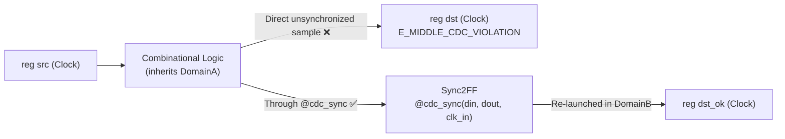

# CDC and Reset Domains

In traditional HDLs such as Verilog, Clock Domain Crossing (CDC) bugs rarely surface at compile time: an asynchronous signal sampled directly by a register in another clock domain often simulates cleanly as 0/1 transitions, only to fail with metastability after synthesis or tape-out.

Syl promotes clock domains (`Clock<D>`) and reset domains (`Reset<D>`) to first-class type parameters. Combined with static dataflow graph analysis and `@cdc_sync` boundary invariants, the compiler rejects unsynchronized crossings and reset polarity mismatches before synthesis.

---

## 1. Static CDC Graph Analysis

Syl's CDC checker (`CdcChecker` in `crates/syl_elab/src/driver/drc/cdc.rs`) runs during elaboration DRC and propagates domain tags across the signal dependency graph:

1. **Launch domain tracking**: Every `reg` and synchronous memory read (`MemorySyncRead`) is bound to its sampling clock domain `D`. Combinational logic driven by that register inherits launch domain `D`.
2. **Capture domain validation**: When a signal reaches the `next` input of a register, a synchronous write port, or an assertion in domain `D_target`, if `D != D_target` and the path does not cross a valid synchronizer boundary, `CdcChecker` emits `DriverError::CdcViolation` (`E_MIDDLE_CDC_VIOLATION`):
   ```
   CDC violation: <signal> launched in <source_domain> sampled by <target> in <target_domain>
   ```
3. **Combinational propagation**: Even through intermediate `signal` bindings, `select`/`match` muxes, or `map` logic, the launch domain tag propagates until it hits a legal `@cdc_sync` boundary.



---

## 2. `@cdc_sync` Invariants and Semantic Checks

To mark legal synchronizer cells (such as a 2-flop synchronizer `Sync2FF`, handshake synchronizer, or async FIFO), Syl provides the `@cdc_sync` attribute.

### Syntax and Argument Rules

In `syl_sema/src/tir/check/cdc_attr.rs`, `TypePhaseChecker::check_cdc_attrs` validates `@cdc_sync` on `cell` and `extern cell` declarations:
- The attribute must take exactly 3 identifier arguments: `@cdc_sync(input_port, output_port, input_clock)` (supporting flattened `interface` view ports named `{port.name}_{field.name}`).
- Any other form emits `TirError::InvalidCdcSyncAttribute` (`E_MIDDLE_INVALID_CDC_ATTR`).

### Boundary Cutting and Re-Launch

In `CdcChecker`, a valid `@cdc_sync` module populates `ModuleCdcSummary`:
- `trusted_async_inputs`: marks `input_port` as a trusted asynchronous input, stopping launch-domain error propagation into the synchronizer.
- `trusted_crossing_outputs`: treats `output_port` as a fresh launch in `dst_clock`, allowing downstream registers in `dst_clock` to sample it safely.
- For structures using `MemorySyncRead` (such as async FIFOs), data paths combinationally reachable from `input_port` to `output_port` are likewise authorized.

---

## 3. Why `inplace` Is Prohibited Across `@cdc_sync`

Syl allows instantiating a `cell` with `inplace` to inline its body into the parent module. However, **using `inplace` on any module with `@cdc_sync` is strictly forbidden**:

- In `EirBuilder::emit_instance` (`crates/syl_elab/src/eir/build/connections/mod.rs`), if `request.inplace` is `true` and `!item.cdc_crossings.is_empty()`, the compiler returns `EirError::InplaceOnCdcSyncCell` (`E_MIDDLE_INPLACE_ON_CDC_SYNC`):
  > `CDC synchronizer <name> requires place to preserve its boundary`

**Why:**
1. **Dissolving the trust boundary**: `emit_cell_inline` flattens the child's registers and wires directly into the parent. Once flattened, the port-to-port `@cdc_sync` boundary disappears, making it impossible for CDC graph analysis to distinguish internal synchronizer flops from an illegal direct crossing.
2. **Preserving synthesis hierarchy**: Downstream STA and synthesis flows rely on an intact module boundary to attach `set_false_path` or `ASYNC_REG` constraints. Requiring `place` guarantees a dedicated SystemVerilog `module` boundary.

(Similarly, `inplace` on an `extern cell` is rejected with `E_MIDDLE_INPLACE_ON_EXTERN_CELL`.)

---

## 4. `OpaqueItemSummary::cdc_crossings`

For external IP cores or `extern cell` declarations, the compiler cannot inspect the implementation body. `OpaqueItemSummary::cdc_crossings` (`crates/syl_sema/src/summary/opaque/cdc.rs` and `model.rs`) models legal internal crossings:

- `SummaryCdcKind` supports `TwoFlopSync`, `Handshake`, `AsyncFifo`, and `Custom`.
- Crossings are collected automatically from `@cdc_sync` attributes on `cell` and `extern cell` items, or injected via `OpaqueItemSummaryBuilder::cdc_crossing`.
- `CdcChecker::crossings()` prefers non-empty `OpaqueSummaryTable` entries over `module.cdc_crossings()`.

---

## 5. Reset Polarity and Reset Domain Checks

Syl also enforces mode, polarity, and domain consistency on `Reset` signals:

### Syntax and Type System

- **Mode (`ResetMode`)**: `Sync` (default) or `Async`.
- **Polarity (`ResetPolarity`)**: `ActiveHigh` (default) or `ActiveLow`.
- **Type parameters**: `Reset<...>` (`syl_sema/src/tir/type_system/reset.rs`) accepts up to 3 arguments: optional domain `D`, optional `Sync`/`Async`, and optional `ActiveHigh`/`ActiveLow`. Invalid qualifiers emit `E_MIDDLE_INVALID_RESET_QUALIFIER`.

### Elaboration Consistency Checks

In `crates/syl_elab/src/eir/build/statements/reset.rs`, every `reg ... reset(rst, val, ...)` is checked for:
1. **Domain match**: `Reset<D>` must match the driving `Clock<C>` domain; mismatches emit `E_MIDDLE_RESET_DOMAIN_MISMATCH`.
2. **Configuration conflict**: explicit `sync`/`async` or `active_high`/`active_low` qualifiers on `reg` must not conflict with `rst`'s `Reset<...>` type; conflicts emit `E_MIDDLE_RESET_CONFIG_CONFLICT`.

### Assertions and SystemVerilog Emission

- Assertions (`assertions.rs`) gate triggers using reset polarity (`reset` directly for `ActiveLow`, `!reset` for `ActiveHigh`).
- `SvPrinter::item` (`crates/syl_emit/src/sv_ir/printer.rs`) emits `or negedge <rst>` (`ActiveLow`) or `or posedge <rst>` (`ActiveHigh`) in `always_ff` sensitivity lists for `Async` resets, and `if (!<rst>)` or `if (<rst>)` inside the block.
