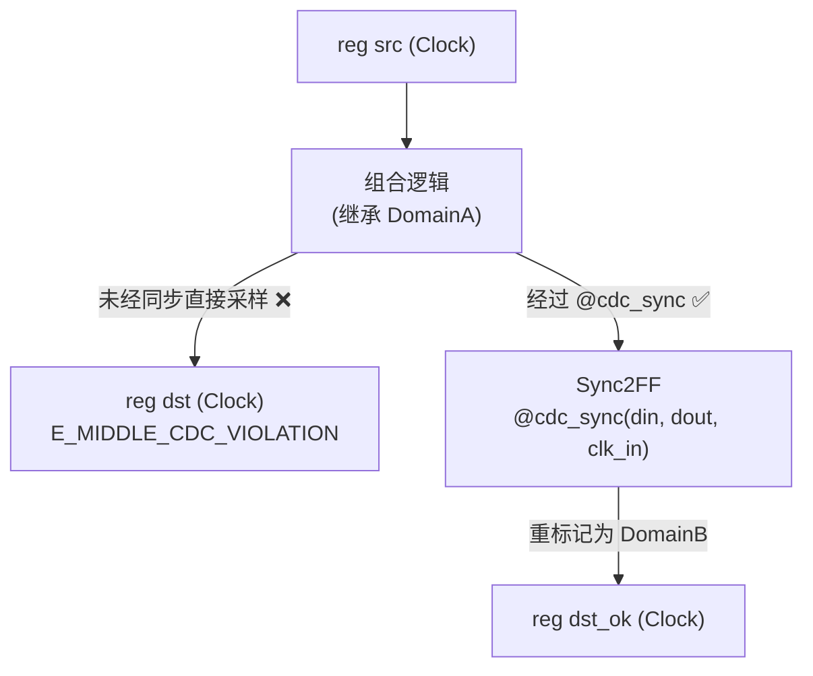

# 跨时钟域（CDC）与复位域分析

在传统 HDL（如 Verilog）中，跨时钟域（Clock Domain Crossing, CDC）错误几乎无法在编译期被发现：异步信号直接被另一个时钟域的寄存器采样，在仿真中可能表现为正常的 0/1 跳变，直到流片或综合后的门级网表才暴露亚稳态故障。传统流程往往依赖昂贵的第三方 CDC 静态分析工具（如 SpyGlass）在综合后补救，且与语言本身脱节。

Syl 将时钟域（`Clock<D>`）与复位域（`Reset<D>`）提升为一等类型参数，并在编译期结合静态数据流图与 `@cdc_sync` 边界不变式，在进入综合前彻底拦截未同步的跨域传输与复位极性冲突。

---

## 一、设计动机：为什么把 CDC 放进编译器？

1. **类型系统只解决“显式连接”，图分析解决“隐式组合穿透”**：即使端口类型标注了 `Clock<DomainA>` 与 `Clock<DomainB>`，普通数据信号（如 `Bit`、`UInt<8>`）本身并不携带时钟域参数。如果没有展开期的数据流图追踪，信号一旦经过 `signal` 中间绑定、`select` 多路选择或 `map` 组合函数，就会丢失来源域信息。
2. **复位极性与模式同样是硬件安全边界**：同步复位与异步复位、高有效与低有效在综合后的触发器模板完全不同。混用极性会导致系统上电后永久处于复位锁定状态或根本无法复位。

---

## 二、CDC 静态图分析模型（`CdcChecker`）

Syl 的 CDC 检查器（`CdcChecker`，位于 `crates/syl_elab/src/driver/drc/cdc.rs`）在展开阶段（DRC）运行，基于驱动事实与信号依赖图执行静态域传播分析：

1. **发射域（Launch Domain）追踪**：每个寄存器（`reg`）与同步存储读（`MemorySyncRead`）绑定到其采样时钟域 `D`。从该寄存器输出的组合逻辑网络继承发射域 `D`。
2. **组合穿透追踪**：即使信号经过了多级 `signal` 赋值、`select`/`match` 多路选择或 `map` 组合逻辑，只要没有经过合法的 `@cdc_sync` 边界，发射域标签就会沿组合路径持续传播。
3. **采样域（Capture Domain）校验**：当信号到达另一个时钟域 `D_target` 的寄存器 `next` 输入、同步写端口（`MemoryWrite`）或时序断言检查点时，若 `D != D_target` 且路径未经过合法的同步器边界，则触发 `DriverError::CdcViolation`（诊断码 `E_MIDDLE_CDC_VIOLATION`）：
   ```
   CDC violation: <signal> launched in <source_domain> sampled by <target> in <target_domain>
   ```



### 反例：未经同步的跨域采样

```syl
cell BadCdc<A: Domain, B: Domain>(
    clk_a: in Clock<A>,
    clk_b: in Clock<B>,
    din: in Bit,
    dout: out Bit,
) {
    reg r_a: Bit
    reg r_b: Bit
    next r_a := din
    // 错误：r_a 由 clk_a 驱动，直接被 clk_b 域寄存器采样
    next r_b := r_a
    dout := r_b
}
```

---

## 三、`@cdc_sync` 不变式与语义校验

为了显式标定合法的跨时钟域同步器（例如双触发器同步器 `Sync2FF`、`Sync2FFAsyncLow`、脉冲同步器 `PulseSynchronizer`、异步 FIFO），Syl 提供了 `@cdc_sync` 属性。

### 1. 语法与参数约束（`syl_sema`）

在 `crates/syl_sema/src/tir/check/cdc_attr.rs` 中，`TypePhaseChecker::check_cdc_attrs` 会在 `cell` 与 `extern cell` 声明期校验 `@cdc_sync`：
- 属性必须精确携带 3 个标识符参数：`@cdc_sync(input_port, output_port, input_clock)`（支持 `interface` 视图端口展开后的 `{port.name}_{field.name}` 命名）。
- 参数数量或格式不符时，立即报告 `TirError::InvalidCdcSyncAttribute`（`E_MIDDLE_INVALID_CDC_ATTR`）。

### 2. 边界截断与新域重发射（`syl_elab`）

在 `CdcChecker` 中，合法的 `@cdc_sync` 模块会生成 `ModuleCdcSummary`：
- `trusted_async_inputs`：标记 `input_port` 为受信任的异步输入，阻断发射域向同步器内部的报错传播。
- `trusted_crossing_outputs`：将 `output_port` 视为在目标时钟域 `dst_clock` 中重新发射的新信号源，从而允许目标域寄存器安全采样。
- 对于包含 `MemorySyncRead` 的异步 FIFO 等结构，若数据路径从 `input_port` 组合可达 `output_port`，同样受该同步边界授权。

---

## 四、为什么禁止 `inplace` 穿透 `@cdc_sync`

Syl 允许在实例化 `cell` 时使用 `inplace` 关键字将子模块内联展开到父模块中，以消除层次边界。然而，**对任何带有 `@cdc_sync` 属性的模块使用 `inplace` 会被编译器严格拒绝**：

- 在 `EirBuilder::emit_instance`（`crates/syl_elab/src/eir/build/connections/mod.rs`）中，若 `request.inplace` 为 `true` 且 `!item.cdc_crossings.is_empty()`，编译器直接返回 `EirError::InplaceOnCdcSyncCell`（`E_MIDDLE_INPLACE_ON_CDC_SYNC`）：
  > `CDC synchronizer <name> requires place to preserve its boundary`

**根本原因**：
1. **语义边界消解**：`emit_cell_inline` 会将子模块的内部寄存器与连线直接扁平化混入父模块。一旦扁平化，`@cdc_sync` 所依赖的“模块端口输入 → 内部同步 → 模块端口输出”的抽象边界就会消失，CDC 图分析器将无法区分同步器内部的亚稳态容忍寄存器与普通的跨域直连。
2. **综合约束隔离**：在下游综合与 STA（静态时序分析）流程中，同步器模块通常需要保留独立层次以施加 `set_false_path` 或 `ASYNC_REG` 属性。强制使用 `place` 实例化能确保生成的 SystemVerilog 保持独立的 `module` 边界。

（同理，对 `extern cell` 使用 `inplace` 也会触发 `E_MIDDLE_INPLACE_ON_EXTERN_CELL`。）

---

## 五、`OpaqueItemSummary::cdc_crossings`

对于外部 IP 核或 `extern cell`，编译器看不到其内部实现。Syl 通过 `OpaqueItemSummary::cdc_crossings`（定义于 `crates/syl_sema/src/summary/opaque/cdc.rs` 与 `model.rs`）描述外部模块的合法跨域路径：

- `SummaryCdcKind` 支持四种同步原语类别：`TwoFlopSync`、`Handshake`、`AsyncFifo` 与 `Custom`。
- 编译器会自动从带有 `@cdc_sync` 的 `cell` / `extern cell` 收集 `SummaryCdcCrossing` 填入 `OpaqueItemSummary`；同时支持通过 Rust Builder API（`OpaqueItemSummaryBuilder::cdc_crossing`）注入精确的第三方 IP 摘要。
- 在 `CdcChecker::crossings()` 中，若 `OpaqueSummaryTable` 存在非空摘要，将优先于模块默认属性参与跨域图校验。

---

## 六、复位极性与复位域校验

除了时钟域，Syl 对复位信号（`Reset`）的模式、极性与所属域也执行严格检查，避免“高有效复位接到低有效寄存器”或“跨时钟域复位”等隐患。

### 1. 语法与类型系统

- **模式（`ResetMode`）**：`Sync`（同步复位，默认）与 `Async`（异步复位），定义于 `syl_syntax/src/ast/reset.rs`。
- **极性（`ResetPolarity`）**：`ActiveHigh`（高有效，默认）与 `ActiveLow`（低有效）。
- **类型参数**：`Reset<...>`（位于 `syl_sema/src/tir/type_system/reset.rs`）最多接受 3 个参数：可选的域参数 `D`、可选的 `Sync`/`Async`、可选的 `ActiveHigh`/`ActiveLow`。非法限定符触发 `E_MIDDLE_INVALID_RESET_QUALIFIER`。

### 2. 展开期域与极性一致性检查

在 `crates/syl_elab/src/eir/build/statements/reset.rs` 中，编译器对每个 `reg ... reset(rst, val, ...)` 执行两项检查：
1. **域匹配检查**：`Reset<D>` 的域参数必须与驱动该寄存器的 `Clock<C>` 域一致，否则报告 `E_MIDDLE_RESET_DOMAIN_MISMATCH`。
2. **配置冲突检查**：寄存器 `reset(...)` 子句中显式指定的 `sync`/`async` 或 `active_high`/`active_low` 若与 `rst` 端口的 `Reset<...>` 类型声明冲突，报告 `E_MIDDLE_RESET_CONFIG_CONFLICT`。

### 3. 断言与 SystemVerilog 发射

- 在断言降级（`syl_elab/src/eir/build/statements/assertions.rs`）中，复位极性决定触发门控逻辑：`ActiveLow` 直接使用 `reset`，`ActiveHigh` 使用 `!reset`。
- 在后端 `SvPrinter::item`（`crates/syl_emit/src/sv_ir/printer.rs`）中：
  - 若为 `Async`，`always_ff` 敏感列表自动生成 `or negedge <rst>`（`ActiveLow`）或 `or posedge <rst>`（`ActiveHigh`）；
  - 块内条件分支自动生成 `if (!<rst>)`（`ActiveLow`）或 `if (<rst>)`（`ActiveHigh`）。
