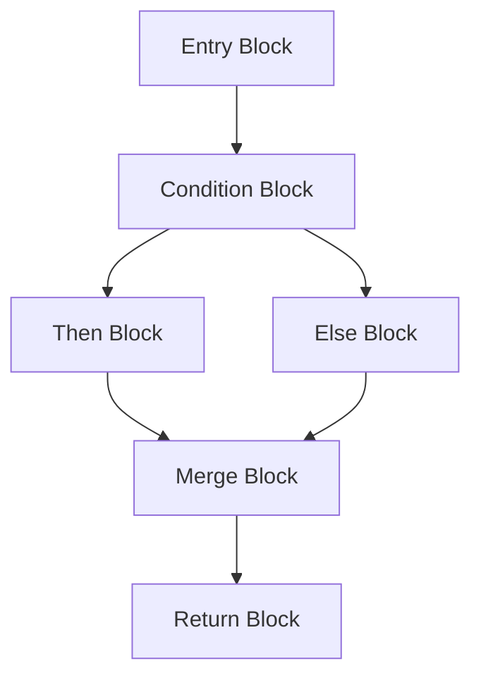
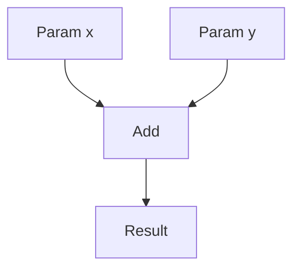
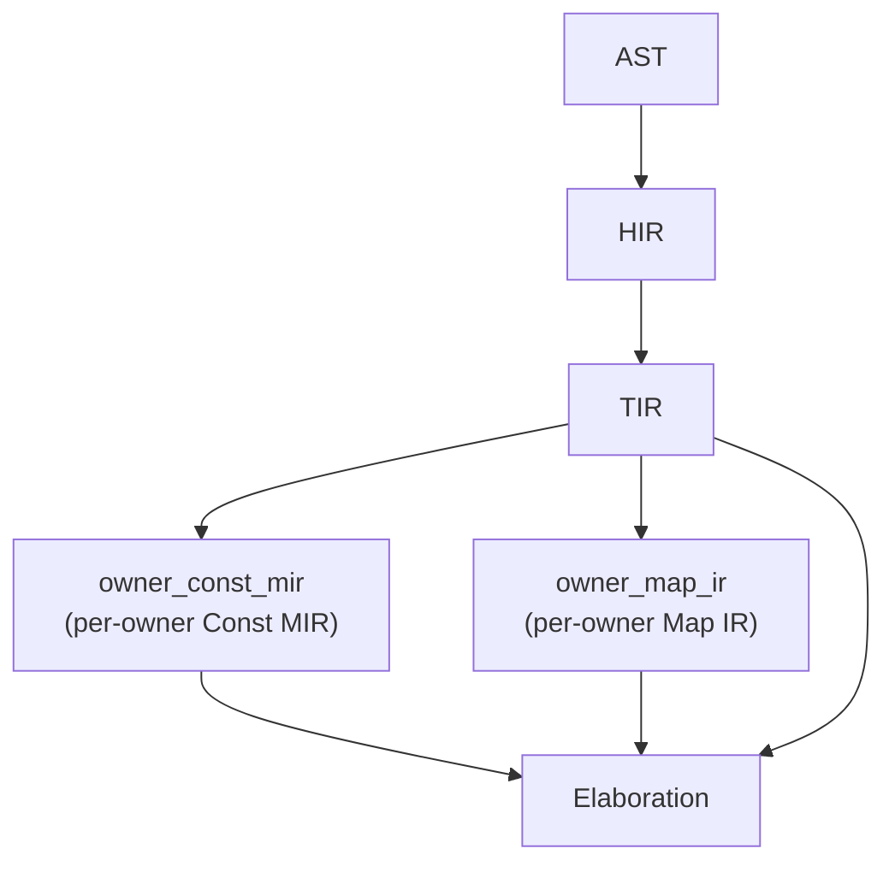

# Const MIR and Map IR

Welcome to the Const MIR and Map IR chapter! Alongside TIR, semantic analysis produces two specialized IRs: Const MIR and Map IR. This page explains what they are, how they work internally, and how they are isolated per owner in the Salsa query pipeline.

---

## What Problems They Solve

Syl has two compile-time evaluable constructs: `fn` (functions) and `map` (combinational maps).

- **`fn` is a callable function** with control flow (branches, loops, `return`). It runs at compile time to compute generic arguments and constant expressions.
- **`map` is a pure combinational mapping** with no control flow, no state, and no side effects. It is inlined into combinational hardware during elaboration.

Because their execution models differ, each uses a dedicated IR.

## Const MIR

Const MIR (Constant Middle-level IR) is the compile-time execution representation for `fn`.

### Control-Flow Graph (CFG)

Const MIR represents a function as basic blocks connected by terminators:

Each basic block contains:
- **Statements**: `Assign` statements binding locals to constant expressions.
- **Terminator**: `Goto(block)`, `Branch { cond, then_block, else_block }`, or `Return(value)`.

### Evaluation

`ConstEvaluator` interprets Const MIR starting from the entry block. To prevent infinite loops, it enforces `step_limit = 10_000` steps, emitting `E_MIDDLE_CONST_STEP_LIMIT` if exceeded.

## Map IR

Map IR represents `map` definitions as pure expression trees (`MapExpr`):

Supported `MapExpr` nodes include `Ident`, `Int`, `Bool`, `Str`, `Unary`, `Binary`, `Call`, `Aggregate`, `Field`, `Index`, `Match`, and `Select`. During elaboration, `map` calls are evaluated bottom-up into combinational hardware expressions.

## Const MIR vs. Map IR

| Feature | Const MIR | Map IR |
|---------|-----------|--------|
| Construct | `fn` | `map` |
| Structure | Control-flow graph (basic blocks) | Expression tree |
| Control flow | Yes (branches, loops, return) | No |
| State | Locals | None |
| Side effects | Forbidden | Forbidden |
| Evaluation | Compile-time interpretation | Elaboration-time inlining |

## Per-Owner Incremental Queries

In `crates/syl_session/src/query/elab.rs`, Const MIR and Map IR are tracked per owner via `owner_const_mir` (`HardwareCompiler::const_mir_stage`) and `owner_map_ir` (`HardwareCompiler::map_ir_stage`). Editing one `fn` or `map` only invalidates that specific owner's query.
