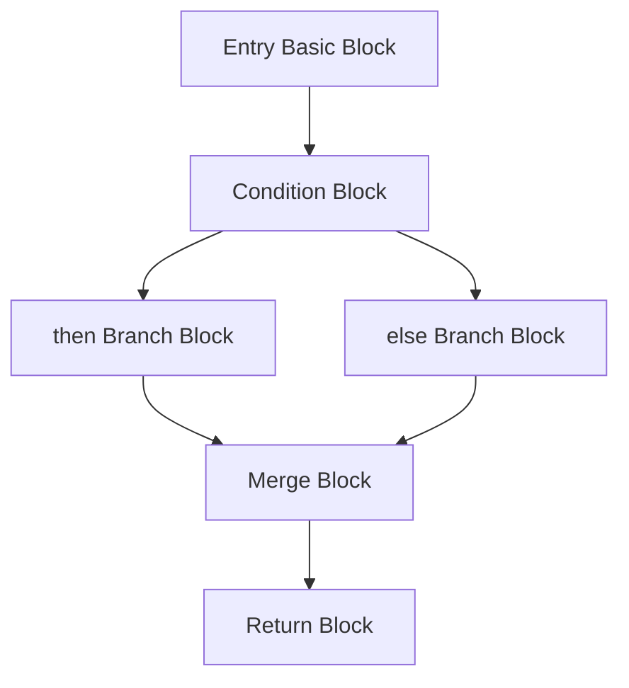
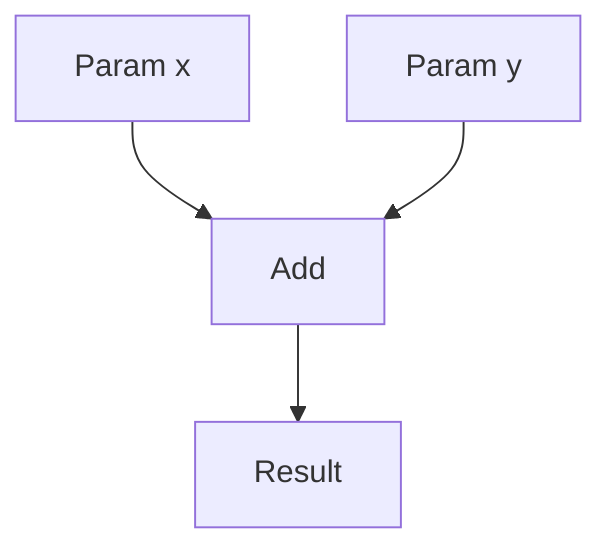
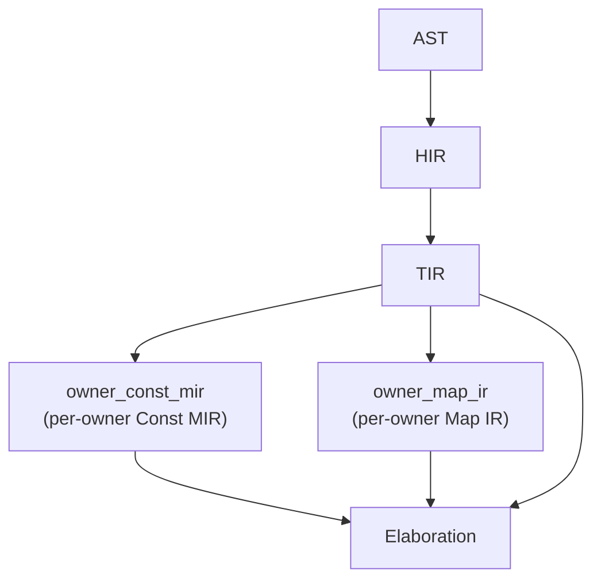

# Const MIR and Map IR

Alongside TIR, semantic analysis produces two specialized intermediate representations: Const MIR for compile-time constant evaluation and Map IR for combinational logic mapping, both integrated with per-owner incremental queries.

---

## What Problems They Solve

Syl has two special compile-time evaluable constructs: `fn` (functions) and `map` (combinational maps). Both are evaluated before hardware emission, but in fundamentally different ways.

**`fn` is a callable function.** It contains control flow: conditional branches, loops, and `return` statements. `fn` executes at compile time, and its results compute generic parameters and constant expressions.

**`map` is a pure combinational mapping.** It has no control flow, no state, and no side effects. `map` is inlined into combinational hardware logic during elaboration.

Because their execution models differ, each requires its own intermediate representation.

## Const MIR

Const MIR (Constant Middle-level Intermediate Representation) is the compile-time execution representation for `fn`.

### What Is a Control-Flow Graph?

Const MIR represents a function as a Control-Flow Graph (CFG) composed of basic blocks. Each basic block contains a sequence of statements and ends with a single terminator instruction.



Basic blocks are connected by terminators:

- **`Goto`**: unconditional jump to another basic block
- **`Branch`**: conditional jump to `then` or `else` block
- **`Return`**: terminates execution and returns a value

### A Concrete Example

For this Syl function:

```syl
fn max(a: Nat, b: Nat) -> Nat {
    if a > b {
        return a
    } else {
        return b
    }
}
```

Const MIR generates three basic blocks:

**Entry block:**
```
local.0 = a
local.1 = b
→ Branch(cond: local.0 > local.1, then: B1, else: B2)
```

**Then branch (B1):**
```
→ Return(local.0)
```

**Else branch (B2):**
```
→ Return(local.1)
```

### Inside a Basic Block

Each basic block has two parts:

**Statement list.** Currently Const MIR supports a single statement kind: `Assign`, which binds a local variable to a constant expression.

**Terminator.** Decides which basic block executes next:
- `Goto(block)`: unconditional jump
- `Branch { cond, then_block, else_block }`: conditional branch on `cond`
- `Return(value)`: return a value

### Evaluation Process

`ConstEvaluator` executes Const MIR starting from the entry block, following terminators until `Return`. To prevent infinite loops, the evaluator enforces `step_limit = 10_000` steps and emits `E_MIDDLE_CONST_STEP_LIMIT` if exceeded.

The evaluated constants are consumed during elaboration to resolve generic parameters and array sizes.

## Map IR

Map IR (Map Intermediate Representation) is the intermediate representation for `map` definitions.

### What Is an Expression Tree?

Map IR represents a `map` as a pure expression tree (`MapExpr`): leaves are literals or parameter references, and internal nodes are operators or calls.



### A Concrete Example

For this Syl `map`:

```syl
map double(x: UInt<8>) -> UInt<8> = x + x
```

Map IR produces:

```
MapExpr::Binary {
    op: Add,
    left: MapExpr::Ident(x),
    right: MapExpr::Ident(x)
}
```

### Supported Expression Nodes

| Node Kind | Description | Example |
|-----------|-------------|---------|
| `Ident` | Parameter reference | `x` |
| `Int` | Integer literal | `42` |
| `Bool` | Boolean literal | `true` |
| `Str` | String literal | `"hello"` |
| `Unary` | Unary operation | `-x`, `not x` |
| `Binary` | Binary operation | `a + b`, `a and b` |
| `Call` | Function call | `add(x, y)` |
| `Aggregate` | Aggregate construction | `Pair { left: x, right: y }` |
| `Field` | Field access | `packet.payload` |
| `Index` | Index access | `arr[0]` |
| `Match` | Pattern match | `match color { ... }` |
| `Select` | Conditional select | `select { a => x, b => y }` |

### Evaluation Process

Map IR is evaluated during elaboration: given argument values for a `map` call, the elaborator evaluates the expression tree bottom-up from leaves to root to produce combinational hardware.

## Const MIR vs. Map IR

| Property | Const MIR | Map IR |
|----------|-----------|--------|
| Construct | `fn` | `map` |
| Data structure | Control-flow graph (basic blocks) | Expression tree |
| Control flow | Yes (branches, loops, return) | No |
| State | Yes (local variables) | No |
| Side effects | Forbidden | Forbidden |
| Evaluation time | Compile-time evaluation | Elaboration-time inlining |
| Evaluation mode | Interpretation | Expression evaluation |

Both disallow side effects, are defined in `syl_sema`, and are consumed by `syl_elab`.

## Dataflow and Per-Owner Incremental Queries



Both Const MIR and Map IR are lowered from TIR (after name resolution and type checking). In the Salsa incremental query architecture (`crates/syl_session/src/query/elab.rs`), they are split into per-owner tracked queries: `owner_const_mir` (`HardwareCompiler::const_mir_stage`) and `owner_map_ir` (`HardwareCompiler::map_ir_stage`).

Editing the body of a single `fn` or `map` only invalidates that owner's query—all other declarations hit Salsa's memo cache directly.
