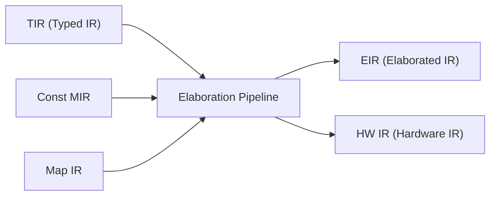
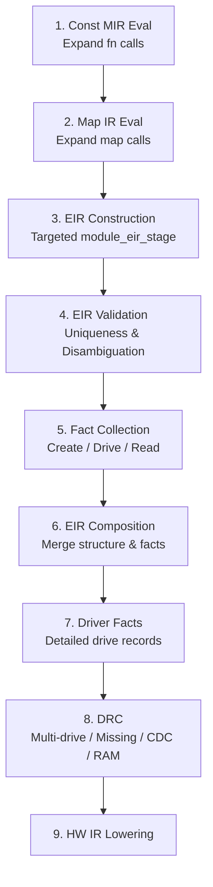

# Elaboration and EIR

Welcome to the Elaboration and EIR chapter! This page dives into the most complex stage of the compiler: elaboration. We review its inputs and outputs, walk through its 9-step internal pipeline, highlight targeted `module_eir_stage` construction, `EirModule::disambiguate`, `mem` primitive lowering, EIR data structures, and Design Rule Checks (DRC), and conclude with HW IR lowering.

---

## Inputs and Outputs

Elaboration takes three inputs from semantic analysis—TIR, Const MIR, and Map IR—and produces two outputs: EIR (Elaborated IR) and HW IR (Hardware IR).



- **TIR**: expression types, binding names, and name resolution results
- **Const MIR**: compile-time evaluation representation for `fn`
- **Map IR**: expression-tree representation for `map`

Elaboration combines these into concrete hardware structures.

## The 9-Step Elaboration Pipeline



### Step 1: Const MIR Evaluation

The elaborator invokes the constant evaluator to run `fn` calls, resolving concrete generic parameters, array sizes, and constant conditions. For example, in `Counter<W = WIDTH>`, `WIDTH` must be evaluated before `Counter`'s port widths are fixed.

### Step 2: Map IR Evaluation

The elaborator evaluates all `map` calls. Because `map` is pure combinational logic, each call is inlined into combinational hardware expressions.

### Step 3: EIR Construction (`module_eir_stage` & `mem` Lowering)

In the incremental pipeline (`syl_elab/src/pipeline/module_stage.rs`), `module_eir_stage` builds EIR per canonical module path (driven by Salsa's `owner_module_eir`):
- Converts every `signal` and `reg` declaration into an EIR object
- Converts every `:=` and `next` assignment into an EIR drive
- Converts every `place` / `inplace` instantiation into a hardware instance (rejecting `inplace` on `@cdc_sync` cells)
- **Lowers `mem` primitives** (`syl_elab/src/eir/build/statements/memory.rs`):
  - `mem` declarations lower to `EirItem::MemoryDecl { name, elem_width, depth, origin }`
  - `mem_write(mem, clk, en, addr, data)` lowers to `EirItem::MemoryWrite`
  - `mem_read_sync(mem, clk, en, addr, target)` lowers to `EirItem::Storage` (`{memory}_rd`), `EirItem::MemorySyncRead`, and an `EirItem::Drive` to `target`

### Step 4: EIR Validation & Name Disambiguation

Checks structural invariants on the raw EIR:
- Module names are unique: `output_from_modules` runs `EirModule::disambiguate` to qualify colliding module names as `canonical_path.join("__")` or with an FNV-1a 32-bit hash suffix, rewriting `EirItem::Instance::module`
- Signal names within each module are unique
- Signal bit-width declarations are valid

### Step 5: Fact Collection

Analyzes three relationships for every EIR object:
- **Creation**: which `signal` and `reg` declarations instantiate which objects
- **Driving**: which assignments connect drivers to targets
- **Reading**: which expressions read each object

### Step 6: EIR Composition

Merges the raw EIR and collected facts into a complete `EirDesign`.

### Step 7: Driver Fact Collection

Builds detailed per-drive records:
- Which module drives which signal
- Whether the drive is combinational (`:=`) or sequential (`next`)
- Under which guard condition the drive is active
- Source span of the drive

### Step 8: Design Rule Checks (DRC)

Uses driver facts to detect hardware rule violations:

**Multiple drivers.** The same signal driven by two distinct sources:

```syl
cell DoubleDrive() -> y: Bit {
    y := 0
    y := 1
}
```

**Missing drivers.** An `out` port with no driver:

```syl
cell NoDriver(y: out Bit) {
    // y is never driven
}
```

**Overlapping drivers.** Multiple branches in `select unique` driving the same target simultaneously:

```syl
signal s: Bit := select unique {
    a => 1,
    b => 1,
}
```

**CDC & memory port conflicts.** `CdcChecker` verifies that cross-domain transfers pass through `@cdc_sync`; `MemoryPortDrcChecker` checks for non-mutually-exclusive write ports on the same `mem` (`E_MIDDLE_DUPLICATE_MEM_WRITE_PORT`).

### Step 9: HW IR Lowering

Lowers EIR into backend-independent HW IR, stripping temporary elaboration state.

## EIR Data Structures

- **`EirModule`**: corresponds to an elaborated module, holding its name, ports, internal objects, drives, and `cdc_crossings` summary.
- **`EirObject`**: represents a signal or register with module, name, bit width, kind (`Signal` or `Storage`), and origin.
- **`EirDrive`**: represents an assignment with target, value expression, drive kind (combinational or sequential), guard, and origin.

EIR is strictly isolated from the backend—the backend only reads HW IR.
