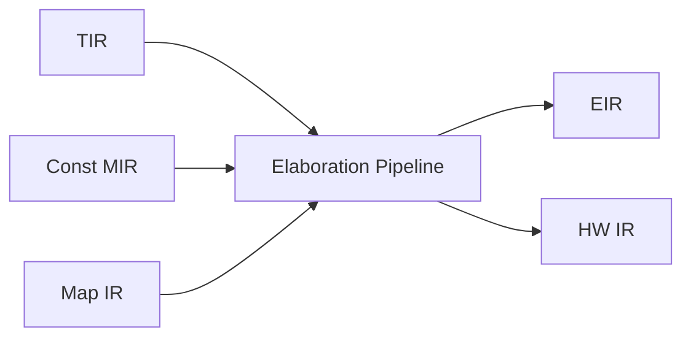
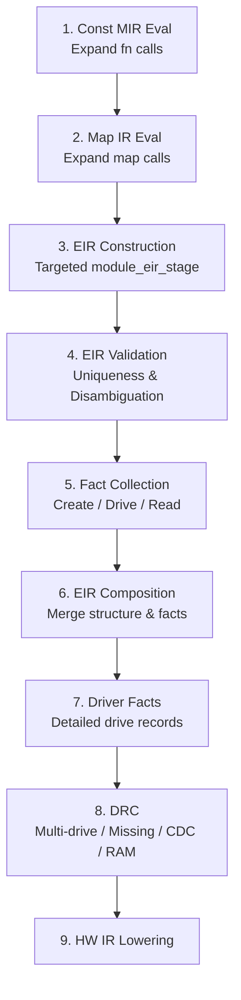

# Elaboration and EIR

Welcome to the Elaboration and EIR chapter! This page dives into the most complex stage of the compiler: elaboration. We review its inputs and outputs, walk through its 9-step internal pipeline, highlight targeted `module_eir_stage` construction, `EirModule::disambiguate`, `mem` primitive lowering, EIR data structures, and Design Rule Checks (DRC), and conclude with HW IR lowering.

---

## Inputs and Outputs

Elaboration takes TIR, Const MIR, and Map IR from semantic analysis and produces EIR (Elaborated IR) and HW IR (Hardware IR):

## The 9-Step Elaboration Pipeline

1. **Const MIR evaluation**: evaluates `fn` calls for generic widths, array sizes, and constant conditions.
2. **Map IR evaluation**: inlines pure combinational `map` calls.
3. **EIR construction (`module_eir_stage` & `mem` lowering)**: in `syl_elab/src/pipeline/module_stage.rs`, `module_eir_stage` builds EIR per canonical module path (driven by Salsa's `owner_module_eir`). It converts `signal`/`reg` declarations to EIR objects, `:=`/`next` to EIR drives, `place`/`inplace` to instances (rejecting `inplace` on `@cdc_sync`), and lowers `mem` primitives (`EirItem::MemoryDecl`, `MemoryWrite`, `MemorySyncRead`).
4. **EIR validation & disambiguation**: checks structural invariants and runs `EirModule::disambiguate` in `output_from_modules` to qualify colliding module names as `canonical_path.join("__")` or with an FNV-1a 32-bit hash suffix, rewriting `EirItem::Instance::module`.
5. **Fact collection**: records creation, drive, and read relationships for every EIR object.
6. **EIR composition**: merges raw EIR and collected facts into `EirDesign`.
7. **Driver fact collection**: records per-drive module, kind (combinational vs. sequential), guard condition, and source span.
8. **Design Rule Checks (DRC)**: detects multiple drivers, missing drivers, overlapping `select unique` drivers, unsynchronized CDC crossings (`CdcChecker`), and non-mutually-exclusive memory write ports (`MemoryPortDrcChecker`).
9. **HW IR lowering**: lowers EIR into backend-independent HW IR.

## EIR Data Structures

- **`EirModule`**: corresponds to an elaborated module, holding its name, ports, objects, drives, and `cdc_crossings` summary.
- **`EirObject`**: represents a signal or storage element with module, name, bit width, kind (`Signal` or `Storage`), and origin.
- **`EirDrive`**: represents an assignment with target, value expression, drive kind, guard, and origin.

EIR is strictly isolated from the backend—the backend only consumes HW IR.
