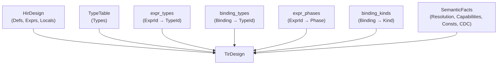
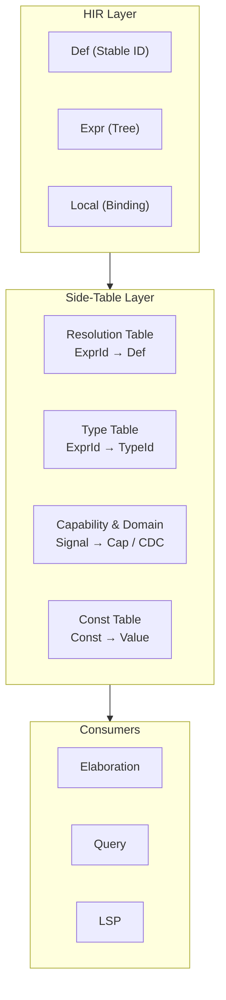

# HIR and TIR

Welcome to the HIR and TIR chapter! This page answers two questions: what HIR and TIR are, and how they relate. We explain why separating them beats a single-pass typed AST, walk through their internal structures with a concrete Syl example, cover `check_fn` / `check_map` declaration-level checks, unused `use` validation, and CDC semantic facts, and explain the side-table pattern.

---

## What Is HIR?

HIR stands for High-level Intermediate Representation.

HIR is the structured representation produced by the first phase of semantic analysis. It has two core jobs:

**1. Desugaring.** Syl provides multiple surface forms for assignments (`x := y`, `next x := y`, module return bindings). HIR normalizes them into a uniform internal assignment representation so downstream stages never care which surface syntax was used.

**2. Assigning stable IDs.** HIR assigns numeric IDs to every definition (`DefId`), expression (`ExprId`), and local binding (`LocalId`). These IDs remain stable across later stages even if file names or line numbers shift.

HIR carries no type information—it is purely a structural skeleton.

## What Is TIR?

TIR stands for Typed Intermediate Representation.

TIR is HIR plus a set of side tables recording expression types, binding types, combinational vs. sequential phases, and semantic facts. TIR has no separate tree structure of its own:

> TIR = HIR + Side Tables

HIR answers "what is the structure?", while TIR answers "what are the types and semantics?".

## Why Two Layers?

Separating HIR and TIR enforces separation of concerns. HIR construction only inspects AST structure and does not depend on name resolution or type checking. Splitting them allows:

- HIR to be built first for basic editor features (go-to-definition, document outline)
- Name resolution to run on HIR (including unused `use` import validation)
- Type checking to run on HIR (including declaration-level `check_fn` and `check_map`)
- Capability and CDC domain checking to run on HIR

Each layer does one job and can be tested and debugged independently.

## Structure of HIR

Defined in `syl_hir`, `HirDesign` consists of six main parts:

- **Definitions (`Def`)**: each top-level item (`cell Top`, `fn add`, `const WIDTH`) with a unique `DefId`.
- **Expressions (`Expr`)**: every expression in a function or cell body with a unique `ExprId` (literals, identifiers, binary ops, calls, aggregates, etc.).
- **Locals (`Local`)**: every `let`, `signal`, and `reg` binding with a unique `LocalId`.
- **Packages (`Package`)**: each source file belongs to a `PackageId`.
- **Imports (`Import`)**: each `use` directive.
- **Name resolution results**: mapping each expression/binding to its target definition.

For example, given:

```syl
const WIDTH: Nat = 8

fn double(x: Nat) -> Nat {
    return x + x
}

const W: Nat = double(WIDTH)
```

HIR records:

| DefId | Kind | Name |
|-------|------|------|
| D0 | ConstItem | WIDTH |
| D1 | FnItem | double |
| D2 | ConstItem | W |

The body `x + x` of `double` is represented as:

```
Expr(Binary {
    op: Add,
    left: Expr(Ident("x")),
    right: Expr(Ident("x"))
})
```

Each `Ident("x")` has its own `ExprId`, and name resolution maps both to parameter `x` of `double`.

## Structure of TIR

Defined in `syl_sema`, `TirDesign` wraps `HirDesign` with side tables:



Specifically:
- **`TypeTable`**: all known types (`Bit`, `UInt<8>`, `UInt<WIDTH>`, `Clock<D>`, `Reset<D>`, etc.), each assigned a `TypeId`.
- **`expr_types`**: maps every `ExprId` to its `TypeId`.
- **`binding_types`**: maps every binding (`let`, `signal`, `reg`, `in`/`out` port) to its `TypeId`.
- **`expr_phases`**: records whether an expression is combinational or sequential.
- **`binding_kinds`**: records whether a binding is a normal local, signal, or register.
- **`SemanticFacts`**: name resolution, port capabilities, constant evaluation results, unused `use` diagnostics, and `@cdc_sync` / clock-domain constraints.

## The Side-Table Pattern

Instead of duplicating the entire AST/HIR into a separate `TypedExpr` / `TypedStmt` tree, side tables keep HIR immutable and attach maps keyed by `ExprId` or `LocalId`:

- **Zero tree duplication**: HIR is never rebuilt for TIR.
- **On-demand computation**: name resolution only populates resolution tables; type checking only populates type tables.
- **Independent evolution**: adding new semantic metadata (such as CDC domain facts) does not require modifying HIR data structures.
- **Testability**: side tables can be unit-tested independently.



Conceptually, `TirDesign` looks like:

```
TirDesign {
    hir: HirDesign,
    type_table: Vec<Type>,
    expr_types: Map<ExprId, TypeId>,
    binding_types: Map<BindingId, TypeId>,
    expr_phases: Map<ExprId, Phase>,
    facts: SemanticFacts,
}
```

## From HIR to TIR

1. **HIR lowering**: AST → HIR (structure only).
2. **Name resolution**: resolve all identifiers and validate unused `use` imports.
3. **Type checking**: compute expression types and run `check_fn` / `check_map` at declaration sites.
4. **Capability & domain checking**: verify port directions, `@cdc_sync` invariants, and reset domains.
5. **Constant evaluation**: evaluate `const` and `fn` expressions.

Each step adds new side tables without mutating HIR.
