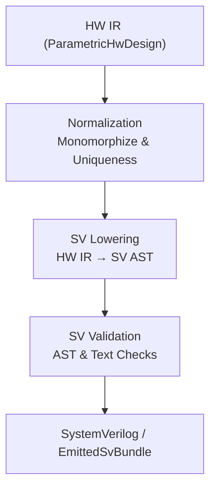

# HW IR and SV Backend

Welcome to the HW IR and SV Backend chapter! This page covers two topics: first, HW IR—the backend-independent interface between elaboration and code generation; second, how `syl_emit` lowers HW IR into SystemVerilog (including multi-file `EmittedSvBundle` / `filelist.f`, source-location comments, sync/async reset polarity, and synthesizable RAM).

---

## HW IR

### What Is HW IR?

HW IR (Hardware Intermediate Representation) is the final output of elaboration and the input to the backend. Defined in `syl_hw`, it depends only on `syl_span` and has zero dependencies on the frontend, semantic analysis, or elaboration.

### Core Data Structures

- **`HwDesign`**: top-level container holding a list of modules.
- **`HwModule`**: module name, generic parameters, ports, and internal items.
- **`HwPort`**: port name, direction (`In`, `Out`, `InOut`), bit width, and source span.
- **`HwItem`**: `Instance`, `ContinuousDrive` (`assign`), `Net`, and memory primitives (`MemoryDecl`, `MemoryWrite`, `MemorySyncRead`).
- **`HwExpr`**: identifiers, literals, binary ops, `select`, and `HighZ` (`'z`).

## Backend (`syl_emit`)

### Normalization

`HwNormalizer` checks name uniqueness, reference validity, and monomorphizes parameterized modules.

### SV Lowering

`SvEmitter` lowers normalized HW IR to SV AST:
- **Source-location comments**: when `EmitOptions::source_comments` is enabled, `SvEmitter::source` emits `// source: <file>:<line>` (with ` (via <callable>:<instance>)` expansion stacks).
- **Sync/async reset polarity**: `SvPrinter::item` (`syl_emit/src/sv_ir/printer.rs`) emits `or negedge <rst>` / `or posedge <rst>` in `always_ff` sensitivity lists for `Async` resets, and `if (!<rst>)` / `if (<rst>)` branches.
- **Synthesizable RAM**: `MemoryDecl` lowers to `reg [W-1:0] <name> [0:D-1];`, while `MemoryWrite` and `MemorySyncRead` lower to `always @(posedge <clk>) if (<en>) ...` blocks.

### Multi-File `EmittedSvBundle` & `filelist.f`

`syl_emit/src/files.rs` provides `SystemVerilogBackend::emit_files` / `emit_files_with_options`, returning `EmittedSvBundle { files, filelist }`. `dependency_order` topologically orders modules (children before parents), validates each `{module.name}.sv` with `SvBackendValidator` and `SvSourceValidator`, and builds `filelist.f`.

### Isolation Between HW IR and Backend

**HW IR does not depend on the backend, and the backend does not depend on the frontend.** Adding a new backend (e.g., VHDL) requires only a new crate depending on `syl_hw`.
