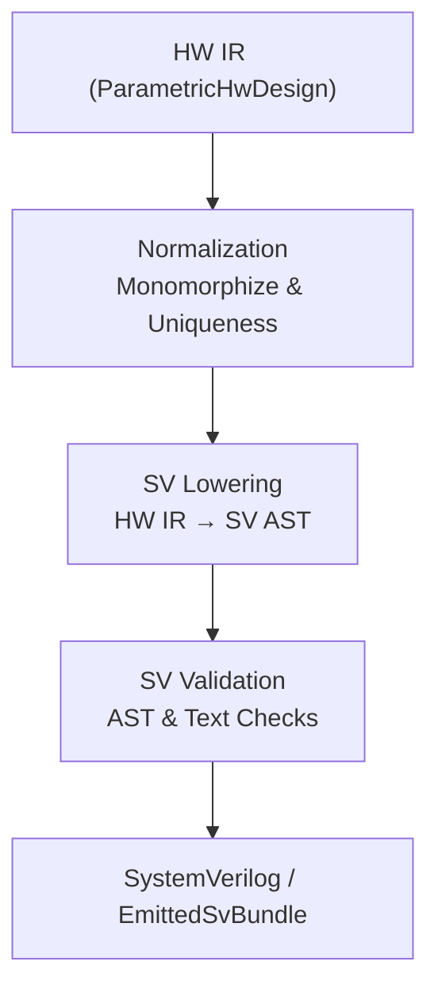
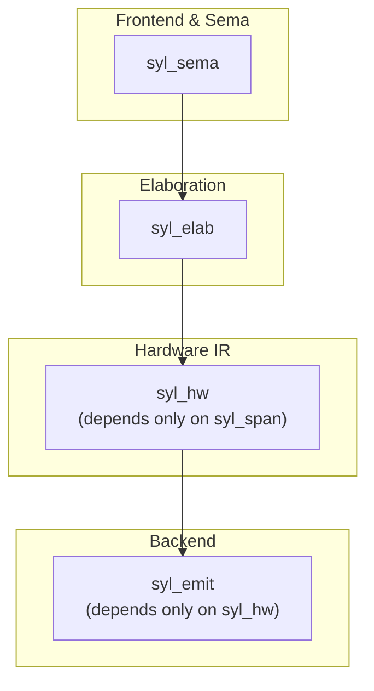

# HW IR and SV Backend

HW IR is the backend-independent interface between elaboration and code generation; the `syl_emit` backend lowers HW IR into SystemVerilog (including multi-file `EmittedSvBundle` / `filelist.f`, source-location comments, sync/async reset polarity, and synthesizable RAM).

---

## HW IR

### What Is HW IR?

HW IR (Hardware Intermediate Representation) is the final output of elaboration and the input to the backend. It is a backend-independent representation: it contains no SystemVerilog-specific syntax or conventions, describing only hardware structure (modules, ports, instances, and connections).

Defined in `syl_hw`, HW IR depends only on `syl_span` and has zero dependencies on the frontend, semantic analysis, or elaboration.

### Core Data Structures

- **`HwDesign`**: top-level container holding a list of modules.
- **`HwModule`**: module name, generic parameter list, port list, and internal items.
- **`HwPort`**: port name, direction (`In`, `Out`, `InOut`), bit width, and source span.
- **`HwItem`**: internal constructs including:
  - `HwItem::Instance`: submodule instantiation
  - `HwItem::ContinuousDrive`: continuous assignment (`assign`)
  - `HwItem::Net`: signal declaration
  - `HwItem::MemoryDecl` / `MemoryWrite` / `MemorySyncRead`: synthesizable memory primitives
- **`HwExpr`**: right-hand side expressions including identifiers, literals, binary operations, `select`, and `HighZ` (`'z`).

### Parametric Designs

`ParametricHwDesign` wraps `HwDesign` to allow modules with unresolved generic parameters. Backend normalization monomorphizes these into concrete instances.

## Backend (`syl_emit`)

The backend takes HW IR and emits SystemVerilog via `syl_emit`.



### Normalization

`HwNormalizer` performs three checks on HW IR:
- **Name uniqueness**: module names and internal object names do not collide.
- **Reference validity**: all referenced modules, signals, and ports exist.
- **Monomorphization**: parameterized modules are expanded into concrete instances.

### SV Lowering

`SvEmitter` lowers normalized HW IR to SV AST:

```
HW IR Construct            → SystemVerilog Construct
──────────────────────────────────────────────────────────
HwModule                   → module … endmodule
HwPort(Direction)          → input / output / inout
HwItem::Instance           → module instantiation
HwItem::ContinuousDrive    → assign
HwExpr::HighZ              → 'z
HwResetMode / Polarity     → always_ff @(posedge clk or negedge/posedge rst)
HwItem::MemoryDecl         → reg [W-1:0] mem [0:D-1];
HwItem::MemoryWrite/Read   → always @(posedge clk) if (en) ...
```

- **Source-location comments**: when `EmitOptions::source_comments` is enabled, `SvEmitter::source` (`syl_emit/src/lower.rs`) emits `// source: <file>:<line>` (with ` (via <callable>:<instance>)` expansion stacks).
- **Sync/async reset polarity**: `SvPrinter::item` (`syl_emit/src/sv_ir/printer.rs`) emits `or negedge <rst>` / `or posedge <rst>` in `always_ff` sensitivity lists for `Async` resets, and `if (!<rst>)` / `if (<rst>)` branches.

### Multi-File `EmittedSvBundle` & `filelist.f`

`syl_emit/src/files.rs` provides multi-file emission:
- `SystemVerilogBackend::emit_files` / `emit_files_with_options` returns `EmittedSvBundle { files, filelist }`.
- `dependency_order` topologically orders modules (children before parents), validates each `{module.name}.sv` with `SvBackendValidator` and `SvSourceValidator`, and builds newline-separated `filelist.f` for downstream tools (Verilator, Yosys).

### SV Validation

SV validation runs in two steps:
1. **Backend validation**: checks SV AST structural integrity (port names/directions, `assign` compatibility, module end markers).
2. **Source validation**: checks balanced delimiters, `begin`/`end`, and `module`/`endmodule` pairs in the emitted text.

### Verilator & Yosys Gates

In CI, emitted SystemVerilog is verified through Verilator lint + C++ co-simulation and Yosys synthesis gates (`mem.sv`, `cdc.sv`) to guarantee synthesizability.

## Isolation Between HW IR and Backend

**HW IR does not depend on the backend, and the backend does not depend on the frontend.**



This isolation means adding a new backend (e.g., VHDL) requires zero changes to HW IR, backend errors never corrupt semantic analysis, and backend tests can construct HW IR directly without running the frontend.
