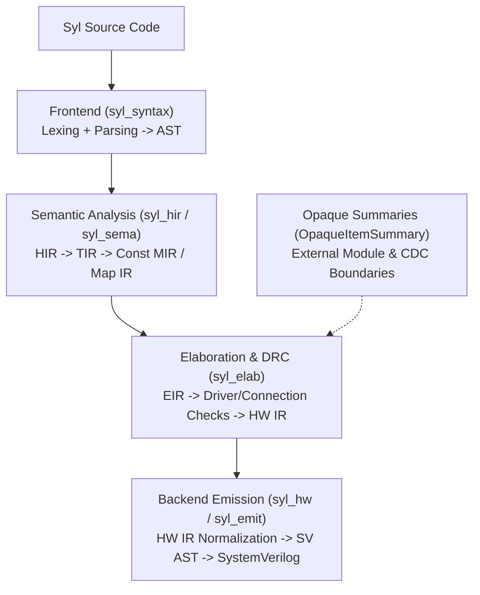

# Explanation Overview

This section examines *why* Syl is designed the way it is and *how* the compiler works under the hood, organized into three themes:

1. **Design Philosophy**: Why Syl is a standalone language with native hardware semantics and static analyzability, and where it fits best.
2. **Static Analysis Model**: How the compiler catches multiple drivers, missing drivers, capability violations, out-of-bounds indexing, incomplete aggregates, width/type mismatches, CDC and reset-polarity errors, and cycles/disambiguation at compile time.
3. **Compiler Internals & Incremental Engine**: The full pipeline from source to SystemVerilog, the strict ownership boundaries across IRs (AST → HIR → TIR → Const MIR / Map IR → EIR → HW IR → SV AST), and the declaration-level incremental query engine powered by Salsa 0.28.2.

---

## 1. Design Philosophy

| Article | Summary |
|---------|---------|
| [What is Syl](/docs/explanation/what-is-syl) | Fundamental differences between a standalone HDL, traditional HDLs, and embedded DSLs (Chisel / SpinalHDL) |
| [Why Static Analyzability Matters](/docs/explanation/why-static-analyzability) | How compile-time hardware semantic checks replace slow simulation debug loops |
| [Users Guide](/docs/explanation/users) | Target audience, suitable project types, migration mappings, and project layout |

## 2. Static Analysis Model

The Syl compiler enforces layered static checks so that any design passing compilation satisfies structural and semantic hardware invariants:

| Article | Summary |
|---------|---------|
| [Driver Overlap](/docs/explanation/driver-overlap) | Single continuous driver rule, `select unique` overlap detection, and submodule driver conflicts |
| [Missing Drivers](/docs/explanation/missing-drivers) | Exhaustive driver coverage for `out` ports, module return values, and conditional branches |
| [Capability Violations](/docs/explanation/capability-violations) | Read/write capability enforcement for `in`, `out`, and `inout` ports |
| [Bounds and Indexing](/docs/explanation/bounds-and-indexing) | Compile-time bounds checking for array indexing, bit selection, and range slices |
| [Aggregate Completeness](/docs/explanation/aggregate-completeness) | Completeness checks for `bundle` fields, `interface` views, `match` arms, and port bindings |
| [Width and Type Mismatches](/docs/explanation/width-and-type-mismatches) | Explicit bit-width rules, `Bit` vs `UInt<1>`, and early interception via `check_fn` / `check_map` |
| [CDC and Reset Domains](/docs/explanation/cdc-and-reset-domains) | Static CDC graph analysis, `@cdc_sync` invariants, `inplace` prohibition, and reset polarity checks |
| [Cycles and Disambiguation](/docs/explanation/cycles-and-disambiguation) | `const` cycles, recursive types, import cycles, and deterministic cross-module name disambiguation |
| [Diagnostic Index](/docs/explanation/diagnostic-index) | Reference list of Syl compiler diagnostic codes, severities, and meanings |

## 3. Compiler Internals & Incremental Engine

The Syl compiler follows a stage-independent, single-owner IR architecture backed by Salsa 0.28.2 incremental queries:

| Article | Summary |
|---------|---------|
| [Compilation Pipeline](/docs/explanation/pipeline) | End-to-end stages and dataflow from source code to multi-file SystemVerilog emission |
| [Salsa Incremental Architecture](/docs/explanation/salsa-incremental-architecture) | Salsa 0.28.2 declaration-level queries, single-parse dedup, LSP fast/slow lane isolation, and benchmarks |
| [Syntax and AST](/docs/explanation/syntax-ast) | Lexing, error-recovering parsing, arena allocation, and `Reset` polarity / `@cdc_sync` syntax |
| [HIR and TIR](/docs/explanation/hir-and-tir) | Stable IDs, name resolution, type inference, `check_fn` / `check_map`, and CDC semantics |
| [Const MIR and Map IR](/docs/explanation/const-mir-and-map-ir) | Pure compile-time evaluation and per-owner `owner_const_mir` / `owner_map_ir` isolation |
| [Elaboration and EIR](/docs/explanation/elab-and-eir) | Targeted `module_eir_stage`, `EirNameDisambiguator`, `mem` primitive lowering, and DRC |
| [HW IR and SV IR](/docs/explanation/hw-and-sv-ir) | Multi-file `EmittedSvBundle` / `filelist.f`, reset polarity SV emission, and synthesizable RAM |
| [Repository Map](/docs/explanation/repository-map) | Workspace crate dependency graph, 13 stdlib modules, and simulation/conformance test layout |
| [Testing and Contributing](/docs/explanation/testing-and-contributing) | `quality_gate.sh`, Verilator + Yosys gates, no-inline-tests rule, and public API snapshots |
