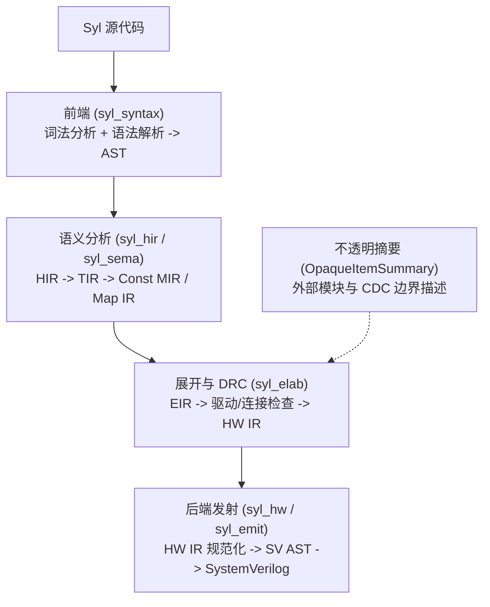

# 原理解析总览

欢迎来到 Syl **原理解析（Explanation）** 象限。本部分面向希望深入理解 Syl 背后“为什么这样设计”以及“编译器内部如何工作”的读者，涵盖三大主题：

1. **设计哲学与定位**：为什么 Syl 选择独立于宿主语言、原生支持硬件语义与静态可分析性，以及它的适用边界。
2. **静态分析模型**：编译期如何拦截多驱动冲突、缺失驱动、端口能力违规、越界索引、聚合不完整、类型与位宽不匹配、跨时钟域 CDC 与复位极性错误，以及循环与跨模块命名消歧。
3. **编译器内部与增量引擎**：从源码到 SystemVerilog 的完整管线、各层 IR（AST → HIR → TIR → Const MIR / Map IR → EIR → HW IR → SV AST）的职责边界，以及基于 Salsa 0.28.2 的声明级增量查询架构。

---

## 一、设计哲学与定位

| 文章 | 核心内容 |
|------|----------|
| [Syl 是什么](/zh/docs/explanation/what-is-syl) | 独立硬件语言与传统 HDL、嵌入式 DSL（Chisel / SpinalHDL）的本质差异 |
| [为什么静态可分析性重要](/zh/docs/explanation/why-static-analyzability) | 编译期硬件语义检查如何替代昂贵的仿真排错循环 |
| [用户指南](/zh/docs/explanation/users) | 目标用户群体、适用场景、迁移对照与项目组织建议 |

## 二、静态分析模型

Syl 编译器在编译期执行多层静态检查，确保通过编译的设计满足硬件结构与语义约束：

| 文章 | 核心内容 |
|------|----------|
| [多驱动冲突](/zh/docs/explanation/driver-overlap) | 单一连续驱动规则、`select unique` 重叠检测与子模块驱动冲突 |
| [缺失驱动](/zh/docs/explanation/missing-drivers) | `out` 端口、返回值与条件分支的驱动覆盖检查 |
| [能力违规](/zh/docs/explanation/capability-violations) | `in` / `out` / `inout` 端口方向与读写权限检查 |
| [边界与索引](/zh/docs/explanation/bounds-and-indexing) | 数组索引、位选择与范围切片的编译期边界检查 |
| [聚合完整性](/zh/docs/explanation/aggregate-completeness) | `bundle` 字段、`interface` 视图、`match` 分支与实例化端口完整性 |
| [类型与宽度不匹配](/zh/docs/explanation/width-and-type-mismatches) | 显式位宽规则、`Bit` 与 `UInt<1>` 区分，以及 `check_fn` / `check_map` 声明期提前拦截 |
| [跨时钟域与复位域](/zh/docs/explanation/cdc-and-reset-domains) | CDC 静态图分析、`@cdc_sync` 不变式、禁止 `inplace` 穿透的原因与复位极性校验 |
| [循环诊断与命名消歧](/zh/docs/explanation/cycles-and-disambiguation) | `const` 循环、递归类型、模块导入环与跨模块确定性硬件命名消歧 |
| [诊断索引](/zh/docs/explanation/diagnostic-index) | Syl 编译器各阶段诊断代码、级别与语义速查 |

## 三、编译器内部与增量引擎

Syl 编译器采用阶段独立、单拥有者（Single Owner）的 IR 架构，并由 Salsa 0.28.2 驱动增量计算：

| 文章 | 核心内容 |
|------|----------|
| [编译流水线](/zh/docs/explanation/pipeline) | 从源代码到多文件 SystemVerilog 发射的完整阶段划分与数据流 |
| [Salsa 增量架构](/zh/docs/explanation/salsa-incremental-architecture) | Salsa 0.28.2 声明级查询、单次解析去重、LSP 快慢通道隔离与压测数据 |
| [语法与 AST](/zh/docs/explanation/syntax-ast) | 词法分析、错误恢复解析、Arena 分配与 `Reset` 极性 / `@cdc_sync` 语法 |
| [HIR 与 TIR](/zh/docs/explanation/hir-and-tir) | 稳定 ID、名字解析、类型推导与 `check_fn` / `check_map` / CDC 语义 |
| [常量 MIR 与 Map IR](/zh/docs/explanation/const-mir-and-map-ir) | 纯函数编译期求值、`owner_const_mir` / `owner_map_ir` 声明级隔离 |
| [展开与 EIR](/zh/docs/explanation/elab-and-eir) | `module_eir_stage` 定向构建、`EirNameDisambiguator`、`mem` 原语降级与 DRC |
| [HW IR 与 SV IR](/zh/docs/explanation/hw-and-sv-ir) | 多文件 `EmittedSvBundle` / `filelist.f`、复位极性 SV 发射与可综合 RAM |
| [仓库地图](/zh/docs/explanation/repository-map) | Workspace crate 依赖拓扑、13 个标准库模块与仿真/一致性测试布局 |
| [测试与贡献指南](/zh/docs/explanation/testing-and-contributing) | `quality_gate.sh`、Verilator + Yosys 门禁、无 inline tests 规范与 API 快照 |
