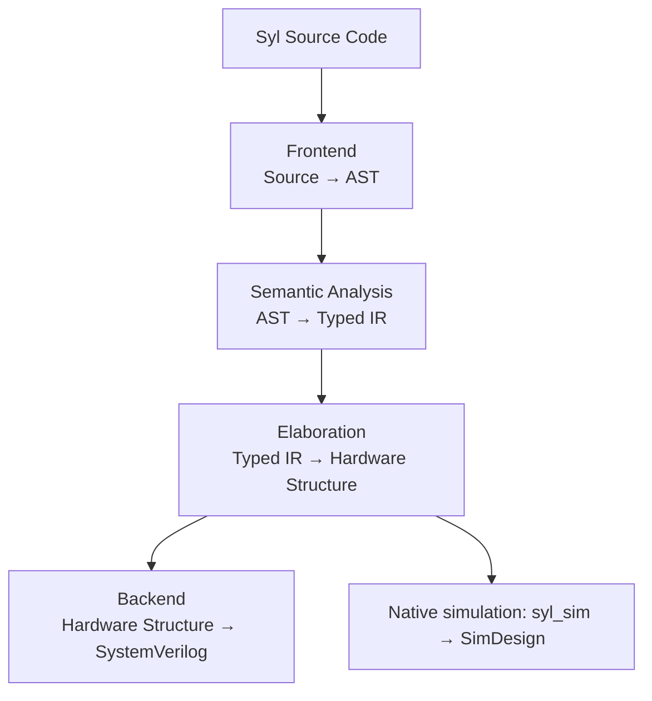
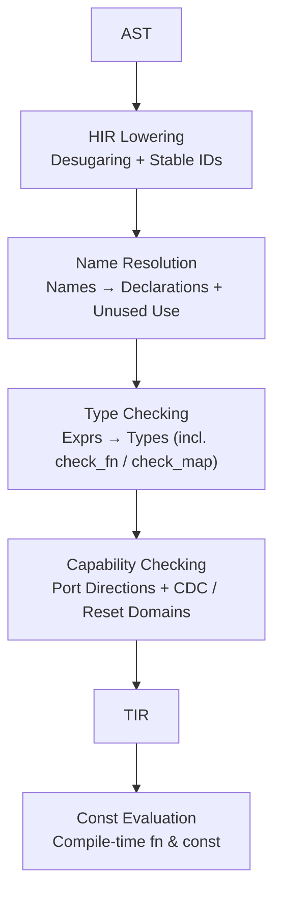
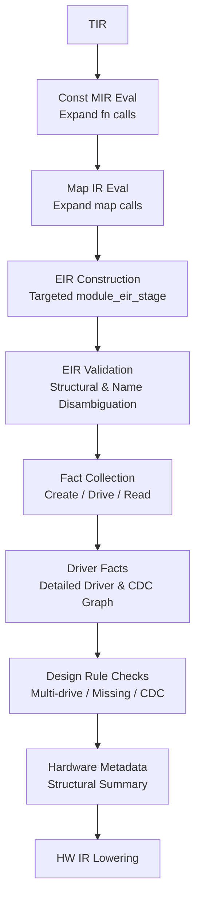
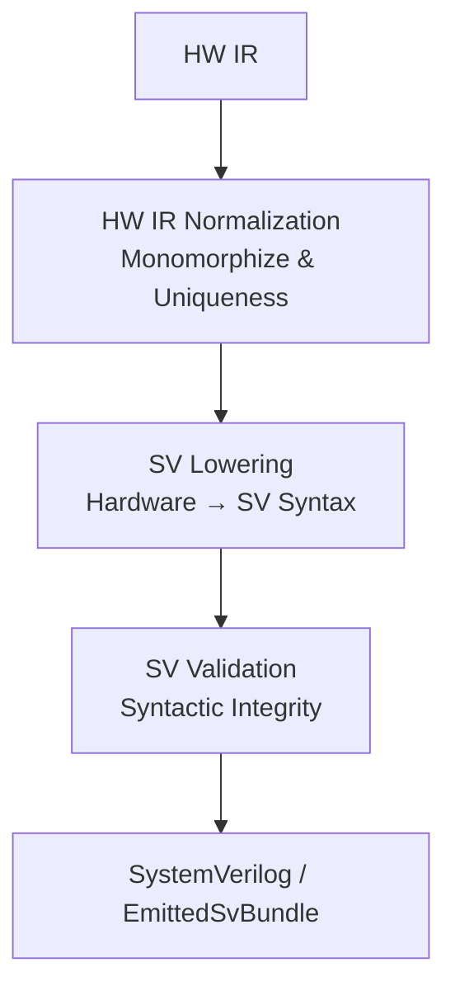

# Compilation Pipeline

The Syl compilation pipeline transforms source code into SystemVerilog through discrete stages—each with defined inputs, checks, and outputs—orchestrated by Salsa 0.28.2 as a declaration-level incremental query pipeline.

---

## From Source Code to SystemVerilog

Starting from source code, the Syl compiler runs through four major stages—Frontend, Semantic Analysis, Elaboration, and Backend—before emitting SystemVerilog (either as a single file or a multi-file `EmittedSvBundle` with `filelist.f`).



Each arrow represents a data transformation that may also emit diagnostics (errors and warnings). In the `syl_session` architecture, these transformations are decomposed into fine-grained Salsa queries—such as single-parse deduplication via `Arc<ParsedFileOutput>`, per-owner `owner_const_mir` / `owner_map_ir`, and targeted `module_eir_stage`—so editing a file only recomputes affected declarations and modules.

For `sylc sim`, `syl_sim` specializes the elaboration output into a word-level `SimDesign`. The reference, CPU SIMD and CUDA backends execute this design directly. [Simulation and GPU acceleration](/docs/explanation/simulation-and-gpu).

## Frontend

### Inputs and Outputs

The frontend takes raw source text and produces an Abstract Syntax Tree (AST).

The AST is a structured representation of the source code containing a list of top-level items (module definitions, function definitions, constant definitions, etc.). It carries no type information or name-resolution results.

### Lexing

The lexer splits source text into a sequence of tokens. Each token records three things: its kind (keyword, identifier, operator, etc.), its text slice, and its start/end span in the source file.

Why lex first? Because the parser operates on meaningful syntactic units such as `:=` (the assignment operator) rather than raw characters `:` and `=`.

### Parsing

The parser groups the token stream into an AST according to Syl's grammar.

At the top level, the parser dispatches on leading keywords: seeing `cell` expects a module name, port list, and body; seeing `fn` expects a function name, parameter list, and body.

For a snippet of Syl code:

```syl
fn add(a: Nat, b: Nat) -> Nat {
    return a + b
}
```

The parser produces:

- Top-level node: Function definition
  - Name: `add`
  - Parameter list: two parameters, each with name and type
  - Return type: `Nat`
  - Body: a block containing a `return` statement

### Error Recovery

If the source contains syntax errors, the parser does not crash. It performs error recovery: skipping unparseable tokens, inserting an error placeholder node into the AST, and resuming at the next top-level declaration. A syntax error inside one module does not corrupt the modules that follow it.

### Lossless Syntax Tree

Alongside the typed AST, the frontend produces a lossless syntax tree that preserves comments and whitespace so the original source can be reconstructed byte-for-byte. The typed AST serves semantic analysis (which ignores comments), while the lossless tree serves the editor/LSP (which needs to know which token sits under the cursor). Both trees come from a single parse pass and are deduplicated across Salsa queries via `Arc<ParsedFileOutput>`.

## Semantic Analysis

### Inputs and Outputs

Semantic analysis takes the AST and produces TIR (Typed Intermediate Representation), along with per-owner Const MIR and Map IR.



### HIR Lowering

HIR lowering converts the AST into HIR with two main responsibilities:

**Desugaring.** Syl offers multiple syntactic forms for assignments (`x := y`, `next x := y`, module return bindings). HIR normalizes them into a uniform internal representation so later stages do not care which surface syntax was used.

**Stable IDs.** Every definition receives a `DefId`, every expression an `ExprId`, and every local binding a `LocalId`. These IDs remain stable across compilation stages.

### Name Resolution

Name resolution binds every identifier to its declaration, answering:

- Is `x` a port, a signal, or a local variable?
- Does `UInt` refer to a built-in type or a user-defined symbol?
- Which symbol does `use std.stream.Stream` import, and are there unused `use` declarations or import cycles?

Unresolved names produce structured compiler errors.

### Type Checking

Type checking computes the type of every expression and verifies assignment and call-site compatibility. In addition, `check_fn` and `check_map` type-check `fn` and `map` bodies directly at their declaration sites without waiting for a call site.

```syl
cell Bad(x: in Bit, y: out UInt<8>) {
    y := x
}
```

Type checking sees `y: UInt<8>` and `x: Bit`, detects the mismatch, and emits a structured diagnostic with the expected/found types and source span.

### Capability and Domain Checking

Syl ports have three directions: `in` (readable, not drivable), `out` (drivable, not readable), and `inout` (both). Capability checking enforces these rules inside every module body, while domain checking validates clock-domain crossing (CDC) boundaries and reset polarity constraints.

### Constant Evaluation

Constant evaluation executes `fn` functions and `const` expressions at compile time. Its results determine generic parameters and array sizes during elaboration.

Constant evaluation runs on Const MIR, a basic-block control-flow graph designed for compile-time interpretation.

## Elaboration

### Inputs and Outputs

Elaboration takes TIR and constant-evaluation results, and produces EIR (Elaborated IR) and HW IR (Hardware IR).

Elaboration is the most complex stage of the compiler: it expands typed descriptions into concrete hardware structures and verifies that those structures are legal.



### Const MIR Evaluation

The elaborator invokes the constant evaluator on Const MIR (the CFG representation of `fn`) to compute compile-time values.

### Map IR Evaluation

Map IR represents `map` definitions as pure combinational expression trees with no state or side effects. The elaborator expands `map` calls into combinational logic.

### EIR Construction

EIR construction lowers TIR into concrete hardware objects. In the incremental pipeline, `module_eir_stage` builds EIR per canonical module path, resolving internal signals, expanding `place` instantiations, lowering `mem` primitives, wiring module connections, and running `EirNameDisambiguator` to guarantee unique cross-module hardware names.

### EIR Validation

Checks structural invariants on EIR: unique module names, unique signal names, and valid width declarations.

### Fact Collection

Analyzes three relationships for every object in EIR:

- **Creation**: which `signal` and `reg` declarations instantiate which objects
- **Driving**: which assignments connect drivers to targets
- **Reading**: which expressions read each object

### Driver Facts

Builds detailed records for each driver operation: which module drives which signal, whether the drive is combinational or sequential, and which clock domain owns it.

### Design Rule Checks (DRC)

Uses driver facts to catch hardware rule violations:

- **Multiple drivers**: the same signal driven by two distinct sources.
- **Missing drivers**: an `out` port with no driver.
- **Overlapping drivers**: multiple branches in `select unique` driving the same target simultaneously.
- **CDC & reset domain violations**: unsynchronized cross-domain transfers without `@cdc_sync`, or reset polarity mismatches.

```syl
cell DoubleDrive() -> y: Bit {
    y := 0
    y := 1
}
```

The compiler reports the conflict location along with both driving sources.

### Hardware Metadata

Summarizes the elaborated structure: port lists per module, inline cell summaries, and aggregated driver facts.

### HW IR Lowering

Lowers EIR into the backend-independent Hardware IR (HW IR), stripping temporary elaboration state.

## Opaque Summaries

### Why Opaque Summaries Are Needed

Sometimes the compiler cannot see a module's implementation:

- An `extern cell` declaration with only a port signature
- A precompiled third-party IP core

The compiler needs a summary describing which signals the module drives and its CDC boundaries.

### What a Summary Contains

- **Endpoints**: port names, directions, types, and capabilities
- **Driven fields**: which outputs the module drives internally
- **CDC crossings (`OpaqueItemSummary::cdc_crossings`)**: legal internal clock-domain crossings
- **Latency class**: combinational vs. sequential
- **Trust boundary**: provenance of the summary (auto-generated from source, vendor-supplied, or user-registered)

### Two Mechanisms

**Declarative summaries.** Declared via `extern cell`; the compiler synthesizes a default summary from port directions (assuming `out` ports are driven).

**Injected summaries.** External IP vendors supply a summary file describing exact behavior (including internal drives or backend constraints).

### Impact on Elaboration

Once registered, summaries participate in fact collection and DRC—their declared drives act as valid driver sources and participate in conflict and CDC graph checks.

## Backend

The backend takes HW IR and emits SystemVerilog (single-file or multi-file `EmittedSvBundle` with `filelist.f`).



### HW IR Normalization

Checks that all referenced names exist, module names and bindings are unique, and monomorphizes parameterized modules into concrete instances.

### SV Lowering

Maps normalized HW IR to SystemVerilog constructs: modules to `module`, ports to `input`/`output`/`inout`, continuous assignments to `assign`, synchronous/asynchronous and active-high/low reset polarities to `always_ff` sensitivity lists and branches, and synthesizable RAM primitives to standard memory arrays, complete with source-location comments.

### SV Validation

Validates the emitted code in two steps:

1. Checks SV AST structural completeness (every module has an end marker).
2. Checks balanced delimiters and module closures in the emitted text.

In CI, emitted SystemVerilog is also verified through Verilator simulation and Yosys synthesis gates.

## Next Steps

- [Salsa Incremental Architecture](/docs/explanation/salsa-incremental-architecture): declaration-level incremental queries and single-parse deduplication
- [Syntax and AST](/docs/explanation/syntax-ast): deep dive into the frontend and AST construction
- [HIR and TIR](/docs/explanation/hir-and-tir): deep dive into the two-layer semantic IR
