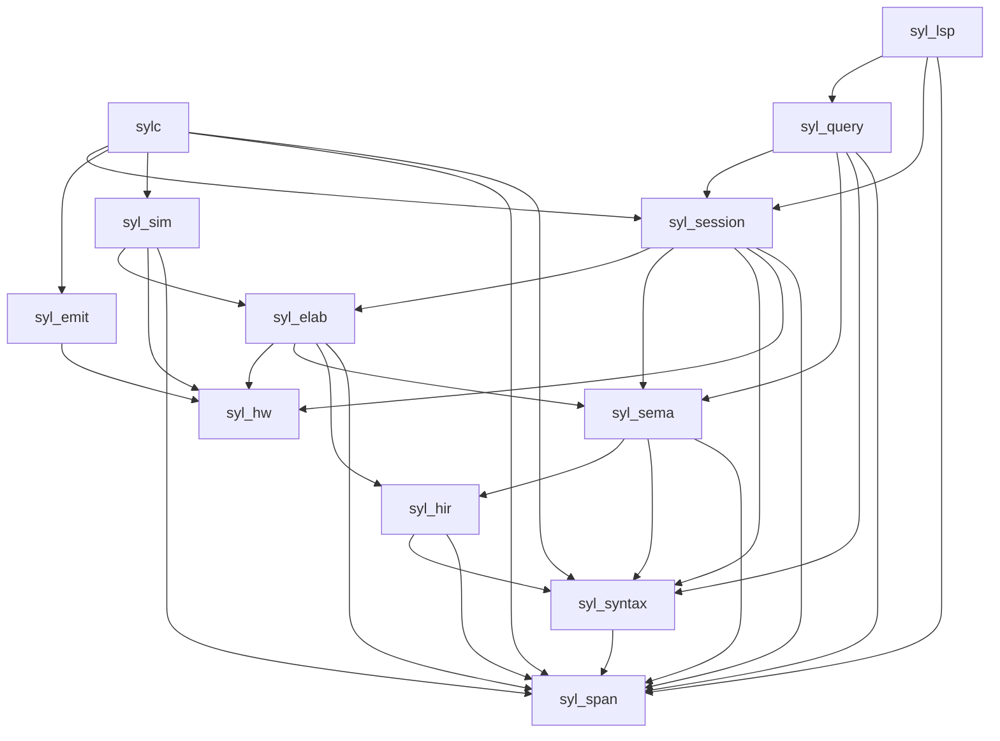

# Repository Map

The Syl repository is organized into focused Rust crates with acyclic dependencies, mapping each compiler responsibility to a dedicated crate.

---

## Top-Level Layout

The Syl compiler repository is a Cargo workspace:

```
syl/
├── api/             # Public API snapshot (public-surface.txt) & consumer index
├── crates/          # Core compiler workspace (14 crates)
├── examples/        # Syl examples & stdlib (13 modules in examples/std/)
├── tests/sim/       # Verilator C++ co-simulation testbenches
├── conformance/     # Conformance test suite
├── docs/            # Internal architecture & design docs
├── scripts/         # Quality gate & simulation scripts
└── fuzz/            # Fuzzing corpus
```

All core compiler logic lives under `crates/`, with each crate owning a stage or cross-cutting concern.

## Crates by Layer

### Foundation Layer

- **`syl_span`**: defines `SourceId`, `Span`, and `Diagnostic`. It is the only crate with zero internal Syl dependencies; every other crate depends on it.
- **`syl_syntax`**: lexing and parsing into typed AST + lossless syntax tree. Depends only on `syl_span`.
- **`syl_hir`**: pure data definitions for HIR (`DefId`, `ExprId`, `LocalId`, `PackageId`, `HirDesign`, `HirExpr`). Contains no analysis algorithms.

### Semantic Analysis Layer

- **`syl_sema`**: name resolution, type checking, capability checking, constant evaluation, TIR, Const MIR, Map IR, and `OpaqueItemSummary`. Depends on `syl_hir`, `syl_syntax`, and `syl_span`.

### Elaboration Layer

- **`syl_elab`**: EIR construction (`module_eir_stage`), `EirModule::disambiguate`, fact collection, DRC (including CDC and memory port checks), and HW IR lowering. Depends on `syl_hir`, `syl_sema`, `syl_hw`, and `syl_span`.

### Hardware & Backend Layer

- **`syl_hw`**: backend-independent HW IR (modules, ports, instances, connections, memory primitives). Depends only on `syl_span`.
- **`syl_emit`**: SystemVerilog lowering, `EmittedSvBundle` / `filelist.f` emission, and SV validation. Depends only on `syl_hw`.
- **`syl_sim`** specializes elaboration output into `SimDesign`, schedules word-level logic, and executes reference, CPU SIMD or CUDA simulation with assertion replay. [Simulation and GPU acceleration](/docs/explanation/simulation-and-gpu).

### Workspace & Tooling Layer

- **`syl_session`**: Salsa 0.28.2 incremental query engine and workspace orchestration. Depends on `syl_syntax`, `syl_sema`, `syl_elab`, and `syl_hw`.
- **`syl_query`**: read-only IDE query engine (hover, go-to-definition, completions, grouped diagnostics). Cannot trigger elaboration or backend emission.
- **`syl_lsp`**: LSP JSON-RPC adapter with fast/background DRC lane isolation. Depends on `syl_query`, `syl_session`, `syl_span`, `tokio`, and `tower-lsp`.

### Entry & Facade

- **`syl`**: top-level library facade crate exporting the public API.
- **`sylc`**: CLI entry point for checking, emission and native simulation.
- **`syl_fuzz`**: parser fuzzing harness used in CI.

## Standard Library (`examples/std/`)

`examples/std/` provides 13 core modules: `arbiter.syl`, `assert.syl`, `bundle.syl`, `cdc.syl`, `fifo.syl`, `logic.syl`, `mem.syl`, `pipeline.syl`, `pulse.syl`, `skid.syl`, `stage.syl`, `stream.syl`, and `vendor.syl`.

## Dependency Topology



Dependencies flow strictly downward toward `syl_span` with zero cycles.

## Forbidden Dependencies

Architecture contract tests in CI enforce strict boundaries:
- **`syl_syntax`** cannot depend on `syl_hir` or `syl_sema`.
- **`syl_hw`** cannot depend on `syl_syntax`, `syl_hir`, or `syl_sema`.
- **`syl_emit`** cannot depend on `syl_elab` or `syl_sema`.
- **`syl_sema`** production code cannot depend on `syl_elab`.
- **`syl_lsp`** cannot depend on `syl_sema`, `syl_elab`, or `syl_hw`.
