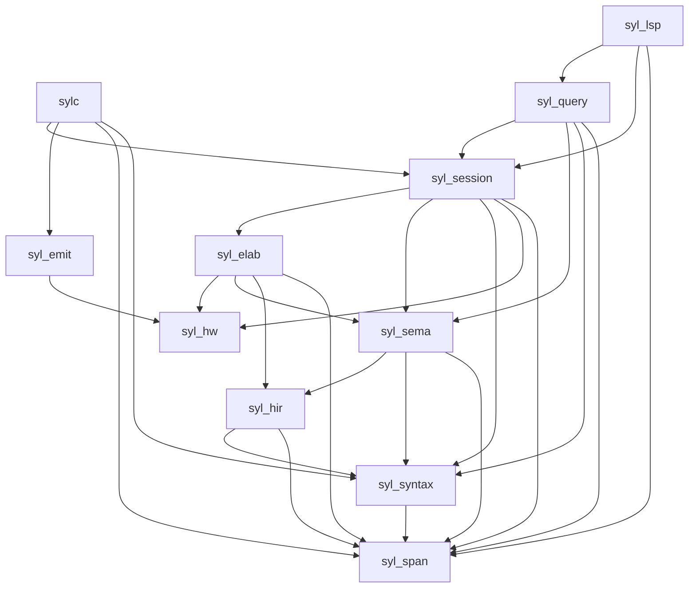

# Repository Map

Welcome to the Repository Map! This page answers two questions: where code lives in the Syl repository, and how the crates depend on one another.

---

## Top-Level Layout

```
syl/
├── api/             # Public API snapshot (public-surface.txt) & consumer index
├── crates/          # Core compiler workspace (13 crates)
├── examples/        # Syl examples & stdlib (13 modules in examples/std/)
├── tests/sim/       # Verilator C++ co-simulation testbenches
├── conformance/     # Conformance test suite
├── docs/            # Internal architecture & design docs
├── scripts/         # Quality gate & simulation scripts
└── fuzz/            # Fuzzing corpus
```

## Crates by Layer

- **Foundation**:
  - `syl_span`: `SourceId`, `Span`, and `Diagnostic`—the only crate with zero internal Syl dependencies.
  - `syl_syntax`: lexing and parsing into typed AST + lossless syntax tree (depends only on `syl_span`).
  - `syl_hir`: pure data definitions for HIR (`DefId`, `ExprId`, `LocalId`, `PackageId`, `HirDesign`).
- **Semantic Analysis**:
  - `syl_sema`: name resolution, type checking, capability checking, constant evaluation, TIR, Const MIR, Map IR, and `OpaqueItemSummary`.
- **Elaboration**:
  - `syl_elab`: EIR construction (`module_eir_stage`), `EirModule::disambiguate`, fact collection, DRC (including CDC and memory port checks), and HW IR lowering.
- **Hardware & Backend**:
  - `syl_hw`: backend-independent HW IR (depends only on `syl_span`).
  - `syl_emit`: SystemVerilog lowering, `EmittedSvBundle` / `filelist.f` emission, and SV validation (depends only on `syl_hw`).
- **Workspace & Tooling**:
  - `syl_session`: Salsa 0.28.2 incremental query engine and workspace orchestration.
  - `syl_query`: read-only IDE query engine (hover, go-to-definition, completions, grouped diagnostics).
  - `syl_lsp`: LSP JSON-RPC adapter with fast/background DRC lane isolation.
- **Entry & Facade**:
  - `syl`: top-level library facade crate.
  - `sylc`: CLI binary entry point.
  - `syl_fuzz`: parser fuzzing harness.

## Standard Library (`examples/std/`)

`examples/std/` contains 13 core modules: `arbiter.syl`, `assert.syl`, `bundle.syl`, `cdc.syl`, `fifo.syl`, `logic.syl`, `mem.syl`, `pipeline.syl`, `pulse.syl`, `skid.syl`, `stage.syl`, `stream.syl`, and `vendor.syl`.

## Dependency Topology



Dependencies flow strictly downward toward `syl_span`. Forbidden edges (such as `syl_syntax -> syl_sema`, `syl_hw -> syl_sema`, `syl_emit -> syl_elab`, or `syl_lsp -> syl_sema`) are enforced by architecture tests in CI.
