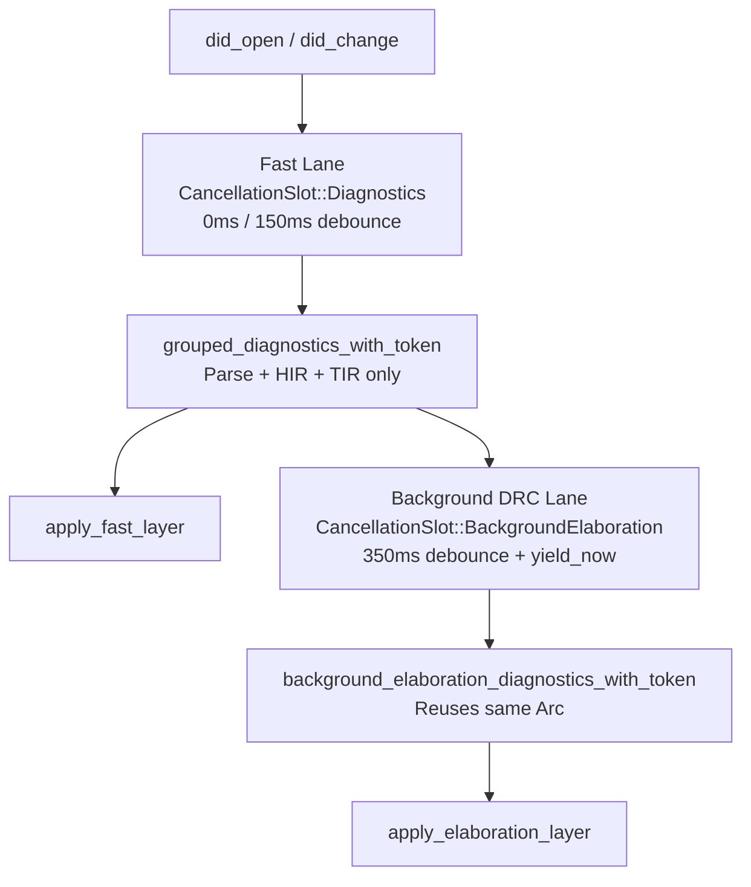

# Salsa Incremental Architecture & Query Engine

The Syl compiler powers both batch CLI compilation (`sylc`) and interactive IDE tooling (`syl_lsp` and `syl_query`). To keep large hardware projects responsive to sub-10ms edits, `syl_session` implements a declaration-level incremental computation engine on top of **Salsa 0.28.2**.

The incremental engine combines the `AnalysisHost` / `AnalysisSnapshot` session model, single-parse deduplication, O(1) generation comparison, `Retained` pointer deduplication, and LSP fast/background lane isolation, achieving sub-millisecond incremental checks across 50- and 100-file benchmarks.

---

## 1. Session and Snapshot Model

`syl_session` is the workspace entry point managing document lifecycle and incremental snapshot publication.

### Document Lifecycle and Snapshots

```rust
let mut host = AnalysisHost::new();
host.open_document(uri, source, version);
host.update_document(uri, new_source, new_version);
host.close_document(uri);

let snapshot = host.snapshot()?;
```

An `AnalysisSnapshot` is an immutable, point-in-time read-only view of compilation results:
- Semantic analysis outputs (HIR, TIR)
- Elaboration outputs (computed on demand)
- Diagnostics grouped by stage and package

If no source files have changed, subsequent queries hit Salsa's memoized cache directly. If the user keeps typing while a query is running, a `QueryToken` cancels the in-flight request—cancelled owners drop their claim without storing a success memo, and the new revision recomputes only affected nodes.

### Thread Safety: `AnalysisSnapshot: Send + Sync`

Salsa 0.28.2's database state is `Send` but not `Sync`. To allow concurrent read-only queries across threads (e.g., the LSP main loop and background Tokio tasks), `AnalysisSnapshot` (`crates/syl_session/src/snapshot/model.rs`) coordinates access via:

- `generation: Arc<Mutex<Generation>>`: holds `SylDatabase`, `RevisionInput`, `generation_id: u64`, and `inputs: BTreeMap<String, SourceFileInput>`.
- `inflight: Arc<RwLock<()>>`: `resolve_and_publish` takes a write lock, while `AnalysisSnapshot::with_db` takes a read lock and clones the `SylDatabase` handle.
- `owned: Arc<Mutex<Option<Arc<Mutex<Generation>>>>>`: if the shared generation has advanced, older snapshots lazily materialize an owned `Generation::from_specs` (`frozen_generation()`) so they always answer from their own inputs.
- `answers: Mutex<Retained>`: deduplicates returned `Arc` answers.

---

## 2. Salsa 0.28.2 Declaration-Level Queries & Core Optimizations

`Cargo.toml` pins `salsa = "=0.28.2"` and `salsa-macro-rules = "=0.28.2"` (because `salsa-macros` 0.28.2 is source-incompatible with `salsa-macro-rules` 0.28.3+). In `crates/syl_session/src/query.rs`, `SylDb` (`#[salsa::db]`) and `SylDatabase` (`storage: salsa::Storage<Self>`) define the tracked query graph.

### 1. Single-Parse Deduplication (`Arc<ParsedFileOutput>`)

Lexing and parsing should never run twice just because semantic analysis wants a typed AST while the LSP wants a lossless syntax tree:

- `ParsedFileOutput` bundles `AstFile`, `AstNodeIndex`, and parse diagnostics.
- `#[salsa::tracked(returns(ref), no_eq)] fn parsed_file(db: &dyn SylDb, file: SourceFileInput) -> Arc<ParsedFileOutput>` invokes `SourceParser::new_in(...).parse_file_partial()`.
- `SnapshotAssembler::add_document` (`crates/syl_session/src/resolver.rs`) calls `PublishStaging::stage_and_parse`, which clones the `Arc<ParsedFileOutput>` into `AnalysisFile.parsed`.

Unchanged files hit Salsa's memo; cloning `AnalysisSnapshot` only performs `Arc::clone` with zero re-parsing.

### 2. O(1) Generation Comparison

On each publish, `PublishStaging::mark_changed` increments `generation.generation_id += 1` before the first input mutation—invalidating older snapshots even if discovery is later cancelled mid-pass.

Inside `AnalysisSnapshot::with_db`, under `inflight.read()`, a single `u64` comparison (`generation.generation_id != self.generation_id`) decides whether to run against the shared DB or fall back to `frozen_generation()`.

### 3. `Retained` Pointer Deduplication

`Retained` (`crates/syl_session/src/snapshot/retain.rs`) stores `hir`, `tir`, `elaboration`, and `opaque` `Vec<Arc<...>>` caches. Each `keep_*` helper checks `entries.iter().find(|entry| Arc::ptr_eq(entry, &value))` before pushing, returning `&*Arc::as_ptr(existing)` to bound memory growth across repeated queries.

### 4. Per-Owner / Per-Module Query Splitting

To prevent editing a single function or cell body from triggering workspace-wide re-elaboration, downstream queries are split by owner (`crates/syl_session/src/query/elab.rs`):
- `owner_hir` / `owner_tir`: per-declaration HIR and TIR.
- `owner_const_mir` / `owner_map_ir`: isolated Const MIR and Map IR per `fn` / `map`.
- `owner_module_eir`: targeted EIR construction per canonical module path.
- `workspace_elaboration`: aggregates driver facts, DRC, and HWIR only when workspace-level checks or emission are requested.

---

## 3. LSP Fast vs. Background DRC Lane Isolation

In interactive editing, users expect instant syntax, name, and type diagnostics, whereas full workspace elaboration and DRC are heavier. `BackgroundDrcScheduler` (`crates/syl_lsp/src/drc/mod.rs`) splits diagnostics into two independently cancellable lanes sharing `generation: u64` and `Option<Arc<AnalysisSnapshot>>`:



1. **Fast lane (`PublishRequest::run_fast`)**: uses `CancellationSlot::Diagnostics`, runs immediately (`Duration::ZERO`) on `did_open`/`did_close`/`initialized` or after a **150 ms** debounce on `did_change`. It runs `grouped_diagnostics_with_token` (Parse, HIR, TIR only) on `tokio::task::spawn_blocking` and publishes via `LspDiagnosticState::apply_fast_layer`.
2. **Background DRC lane (`PublishRequest::run_background`)**: after the fast layer publishes, acquires `CancellationSlot::BackgroundElaboration`, waits a **350 ms** debounce plus `tokio::task::yield_now().await`, and runs `background_elaboration_diagnostics_with_token` on the exact same `Arc<AnalysisSnapshot>` (no host re-lock or re-publish), merging deltas via `apply_elaboration_layer`.

`LspDiagnosticState` rejects stale generations (`generation < latest_generation` for fast; `generation != latest_generation` for elaboration) and stale document versions so diagnostics never regress.

---

## 4. 50 / 100-File Scale Benchmarks

From `docs/query-driven-perf.md` (measured 2026-11-21 on AMD Ryzen 9 7950X, 32 threads, Linux, `rustc 1.96.0 --release`, 4-layer DAGs producing 65 / 130 HWIR modules, n=7 samples):

| Metric | 50 Files (p50 / p95 µs) | 100 Files (p50 / p95 µs) |
|--------|------------------------|-------------------------|
| Cold load through HWIR (`cold_load_hwir_us`) | 54,374 / 75,355 | 131,332 / 140,093 |
| Leaf body edit — IDE queries (`leaf_body_edit_ide_us`) | **1,629 / 1,691** | **3,039 / 3,210** |
| Leaf body edit — HWIR (`leaf_body_edit_hwir_us`) | 14,585 / 18,783 | 38,701 / 44,046 |
| Constant signature edit (4 leaves) — HWIR (`sig_edit_hwir_us`) | 23,154 / 26,931 | 50,812 / 53,156 |
| Cold load through SV emit (`cold_load_emit_us`) | 61,788 / 89,613 | 142,965 / 167,579 |
| Post-drop process RSS / HWM (`/proc/self/status`) | 59,488 / 59,488 KB | 101,592 / 101,592 KB |

Query execution deltas (identical at 50 and 100 files):
- **Leaf body edit (IDE)**: `parse_delta=1`, `owner_hir_delta=1`, `owner_tir_delta=1`, `owner_module_eir_delta=0`, `workspace_elab_delta=0` (~1.6 ms / 3.0 ms).
- **Leaf body edit (HWIR)**: `parse_delta=1`, `owner_hir_delta=1`, `owner_tir_delta=1`, `owner_module_eir_delta=1`, `workspace_elab_delta=1`.
- **Constant signature edit (HWIR)**: `parse_delta=1`, `owner_hir_delta=20`, `owner_tir_delta=20`, `owner_module_eir_delta=4`, `workspace_elab_delta=1`.

---

## 5. Read-Only Query API

Editors and tools access compilation results through `AnalysisSnapshot`:

```rust
let hover = snapshot.hover_at(uri, position)?;
let definition = snapshot.definition_at(uri, position)?;
let completions = snapshot.completions_at(uri, position)?;
let grouped = snapshot.grouped_diagnostics();
```

- **Hover (`hover_at`)**: type, port direction, and doc comments at cursor.
- **Go to definition (`definition_at`)**: cross-file declaration lookup via HIR name resolution and `DemandResolver`.
- **Completions (`completions_at`)**: scope-aware and `interface`/`bundle` member candidates.
- **Grouped diagnostics (`grouped_diagnostics`)**: structured diagnostics organized by stage (Parse / HIR / TIR / Elaboration) and package.
