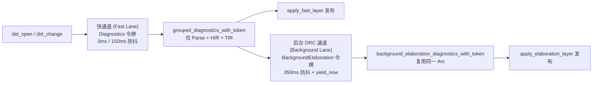

# Salsa 增量架构与查询引擎

Syl 编译器不仅服务于命令行批处理（`sylc`），还直接驱动交互式语言服务器（`syl_lsp`）与只读查询引擎（`syl_query`）。为了让大型硬件工程在编辑时保持毫秒级响应，Syl 在 `syl_session` 中构建了一套基于 **Salsa 0.28.2** 的声明级增量计算引擎。

本文从 `AnalysisHost` 与 `AnalysisSnapshot` 的会话模型出发，深入剖析单次解析去重、O(1) 代际比对、`Retained` 指针去重、LSP 快慢双通道隔离，以及 50/100 文件规模下的真实压测表现。

---

## 一、Session 与 Snapshot 会话模型

`syl_session` 是编译器的工作区入口，负责管理源文件的打开、更新、关闭与增量快照发布。

### 文档生命周期与快照获取

```rust
let mut host = AnalysisHost::new();
host.open_document(uri, source, version);
host.update_document(uri, new_source, new_version);
host.close_document(uri);

let snapshot = host.snapshot()?;
```

`AnalysisSnapshot` 是某一时刻编译结果的只读视图，包含：
- 语义分析结果（HIR、TIR）
- 展开结果（按需触发）
- 按阶段与包分组的诊断信息

如果源文件没有变化，后续查询直接命中 Salsa 记忆化缓存（Memo）。如果用户在查询进行中继续输入，查询令牌（`QueryToken`）会触发取消机制：被取消的请求不会将未完成的结果写入成功缓存，新的修订版随即从受影响的查询节点重新计算。

### 线程安全：`AnalysisSnapshot: Send + Sync`

Salsa 0.28.2 的数据库内部状态是 `Send` 但非 `Sync` 的。为了支持跨线程并发只读查询（例如 LSP 主循环与后台 tokio 任务同时读取快照），`AnalysisSnapshot`（位于 `crates/syl_session/src/snapshot/model.rs`）通过以下同步原语实现 `Send + Sync`：

- `generation: Arc<Mutex<Generation>>`：封装 `SylDatabase`、`RevisionInput`、`generation_id: u64` 与 `inputs: BTreeMap<String, SourceFileInput>`。
- `inflight: Arc<RwLock<()>>`：读写锁协调发布与查询。`resolve_and_publish` 持有写锁，而 `AnalysisSnapshot::with_db` 持有读锁并克隆 `SylDatabase` 句柄。
- `owned: Arc<Mutex<Option<Arc<Mutex<Generation>>>>>`：当底层共享代际已被新发布推进时，旧快照惰性构造独立拥有的 `Generation::from_specs`，确保旧快照始终从自己的输入集合回答查询（Snapshot Isolation）。
- `answers: Mutex<Retained>`：缓存已返回的 `Arc` 回答。

---

## 二、Salsa 0.28.2 声明级查询与四项核心优化

在 `Cargo.toml` 中，Syl 显式锁定 `salsa = "=0.28.2"` 与 `salsa-macro-rules = "=0.28.2"`（避免 `salsa-macros` 0.28.2 与 0.28.3+ 的源码不兼容）。在 `crates/syl_session/src/query.rs` 中，`SylDb`（`#[salsa::db]`）与 `SylDatabase`（`storage: salsa::Storage<Self>`）定义了核心输入与追踪查询。

### 1. 单次解析去重（`Arc<ParsedFileOutput>`）

在大型工程中，词法分析与语法解析不应因为“语义分析需要 AST”和“LSP 需要无损树”而执行两次：

- `ParsedFileOutput` 同时打包 `AstFile`、`AstNodeIndex` 与解析诊断。
- `#[salsa::tracked(returns(ref), no_eq)] fn parsed_file(db: &dyn SylDb, file: SourceFileInput) -> Arc<ParsedFileOutput>` 调用 `SourceParser::new_in(...).parse_file_partial()`。
- `SnapshotAssembler::add_document`（`crates/syl_session/src/resolver.rs`）通过 `PublishStaging::stage_and_parse` 直接复用 `Arc::clone(parsed_file(...))` 并存入 `AnalysisFile.parsed`。

未修改的文件直接命中 Salsa Memo；克隆 `AnalysisSnapshot` 仅执行 `Arc::clone`，实现零重复解析。

### 2. O(1) 代际比对（Generation Comparison）

每次发布新修订时，`PublishStaging::mark_changed` 在第一次输入变更前原子递增 `generation.generation_id += 1`（即使后续发现阶段被取消，旧快照也会被正确标记为过期）。

当查询调用 `AnalysisSnapshot::with_db` 时，只需在 `inflight.read()` 保护下执行一次 `u64` 整数比对（`generation.generation_id != self.generation_id`）：
- 若相等，直接克隆 `(generation.db.clone(), generation.revision)` 在共享数据库上执行；
- 若不等，则释放读锁并回退到 `frozen_generation()`，在 `self.owned` 上隔离执行。

### 3. `Retained` 指针去重

`crates/syl_session/src/snapshot/retain.rs` 中的 `Retained` 结构持有 `hir`、`tir`、`elaboration` 与 `opaque` 四个 `Vec<Arc<...>>`。每次通过 `keep_hir` / `keep_tir` / `keep_elaboration` / `keep_opaque` 保留结果时，都会先用 `Arc::ptr_eq(entry, &value)` 检查是否已存在相同指针：若存在则直接返回既有引用 `&*Arc::as_ptr(existing)`，避免重复压入 `Arc`，在长生命周期快照中有效控制内存增长。

### 4. 声明/Owner 粒度查询拆分

为了防止修改单个函数或模块体部触发全工作区重展开，编译器将下游查询拆分为声明/Owner 粒度（`crates/syl_session/src/query/elab.rs`）：
- `owner_hir` / `owner_tir`：按声明归属隔离 HIR 与 TIR。
- `owner_const_mir` / `owner_map_ir`：独立追踪每个 `fn` 与 `map` 的编译期求值 IR。
- `owner_module_eir`：按规范路径定向构建单模块 EIR。
- `workspace_elaboration`：仅在需要全工作区 DRC 或 HWIR 发射时聚合驱动事实与跨模块检查。

---

## 三、LSP 快慢双通道隔离

在编辑器交互场景中，用户最敏感的是输入时的语法、名字与类型提示延迟，而全工作区展开与跨模块 DRC（设计规则检查）计算量相对较大。为此，`crates/syl_lsp/src/drc/mod.rs` 中的 `BackgroundDrcScheduler` 将诊断发布拆分为两个可独立取消的通道，共享同一 `generation: u64` 与 `Option<Arc<AnalysisSnapshot>>`：



1. **快通道（`PublishRequest::run_fast`）**：使用 `CancellationSlot::Diagnostics`。在 `did_open` / `did_close` / `initialized` 时立即执行（`Duration::ZERO`），在 `did_change` 时采用 **150 ms** 防抖。它在 `tokio::task::spawn_blocking` 上运行 `grouped_diagnostics_with_token`（仅包含 Parse、HIR、TIR，展开组为空），并通过 `LspDiagnosticState::apply_fast_layer` 发布。
2. **后台 DRC 通道（`PublishRequest::run_background`）**：在快通道发布后，获取 `CancellationSlot::BackgroundElaboration` 令牌，经过 **350 ms** 防抖与 `tokio::task::yield_now().await` 让出调度后，直接在同一个 `Arc<AnalysisSnapshot>` 上运行 `background_elaboration_diagnostics_with_token`（无需重新锁定或发布 Host），并通过 `apply_elaboration_layer` 增量合并。

`LspDiagnosticState` 会严格拒绝过期代际（快通道拒绝 `generation < latest_generation`，后台通道拒绝 `generation != latest_generation`）与过期文档版本，确保编辑器诊断永不回退。

---

## 四、50 / 100 文件规模压测数据

根据 `docs/query-driven-perf.md` 记录的基准测试（2026-11-21，AMD Ryzen 9 7950X 32 线程，Linux，rustc 1.96.0 `--release`，4 层 DAG 拓扑分别生成 65 / 130 个 HWIR 模块，n=7 样本）：

| 指标 | 50 文件 (p50 / p95 µs) | 100 文件 (p50 / p95 µs) |
|------|----------------------|-----------------------|
| 冷加载至 HWIR (`cold_load_hwir_us`) | 54,374 / 75,355 | 131,332 / 140,093 |
| 叶子模块体部编辑 — IDE 查询 (`leaf_body_edit_ide_us`) | **1,629 / 1,691** | **3,039 / 3,210** |
| 叶子模块体部编辑 — HWIR (`leaf_body_edit_hwir_us`) | 14,585 / 18,783 | 38,701 / 44,046 |
| 常量签名编辑（影响 4 个叶子）— HWIR (`sig_edit_hwir_us`) | 23,154 / 26,931 | 50,812 / 53,156 |
| 冷加载至 SV 发射 (`cold_load_emit_us`) | 61,788 / 89,613 | 142,965 / 167,579 |
| 释放后进程 RSS / HWM (`/proc/self/status`) | 59,488 / 59,488 KB | 101,592 / 101,592 KB |

查询执行增量（50 文件与 100 文件完全一致）：
- **叶子体部编辑（IDE）**：`parse_delta=1`, `owner_hir_delta=1`, `owner_tir_delta=1`, `owner_module_eir_delta=0`, `workspace_elab_delta=0`（约 1.6 ms / 3.0 ms）。
- **叶子体部编辑（HWIR）**：`parse_delta=1`, `owner_hir_delta=1`, `owner_tir_delta=1`, `owner_module_eir_delta=1`, `workspace_elab_delta=1`。
- **常量签名编辑（HWIR）**：`parse_delta=1`, `owner_hir_delta=20`, `owner_tir_delta=20`, `owner_module_eir_delta=4`, `workspace_elab_delta=1`。

---

## 五、Query 只读查询接口

在 `syl_query` 与 `AnalysisSnapshot` 上，编辑器和工具链可通过统一接口获取只读结果：

```rust
let hover = snapshot.hover_at(uri, position)?;
let definition = snapshot.definition_at(uri, position)?;
let completions = snapshot.completions_at(uri, position)?;
let grouped = snapshot.grouped_diagnostics();
```

- **悬停提示（`hover_at`）**：查询光标位置的类型、端口方向与文档注释。
- **跳转定义（`definition_at`）**：通过 HIR 名字解析与 `DemandResolver` 跨文件定位声明。
- **自动补全（`completions_at`）**：基于当前作用域与 `interface` / `bundle` 成员提供候选。
- **分组诊断（`grouped_diagnostics`）**：按阶段（Parse / HIR / TIR / Elaboration）与包返回结构化诊断。
