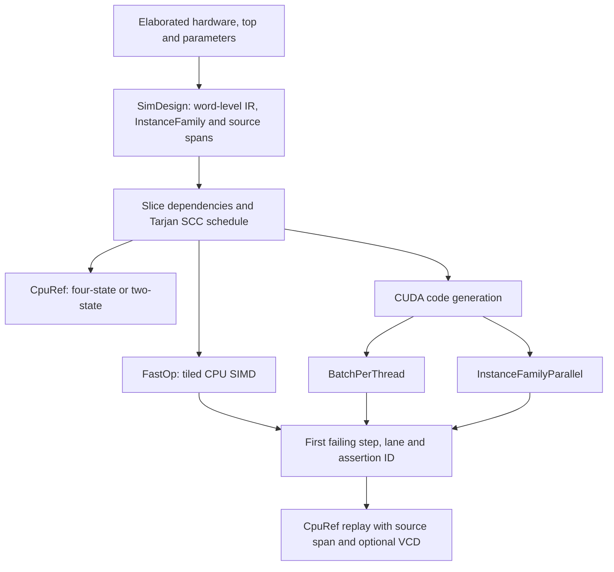

## One specialized design, independent state

`SimDesign::lower` takes `syl_elab::ElaborationOutput`, a top cell and its parameter bindings. It evaluates widths and generated scopes, flattens interface ports, and assigns concrete IDs to signals, registers, RAM ports and assertions. An `InstanceFamily` groups instances by canonical module and evaluated bindings. Its members share a template while retaining private storage, hierarchical paths and source spans. This is what lets a GPU execute one copy of a child’s code and still report which instance failed.

A whole-word dependency can look cyclic when two assignments access disjoint slices of a packed bus. Lowering splits fixed reads, copies and bitwise AND/OR/XOR at connected slice boundaries. Tarjan’s strongly connected components (SCCs) identify actual combinational feedback across instances. In an acyclic graph, `comb_eval_order` lists executable assignments with their dependencies first. Registers and synchronous RAM read outputs break combinational paths.

## Values, edges and assertions

T2 `CpuRef` represents each packed `Value` with data and unknown bit planes. A known bit uses the data plane directly. Under an unknown bit, data 0 encodes X and data 1 encodes Z. Uninitialized registers, RAM words and synchronous read outputs start at X. Coincident clock edges sample old storage before committing updates together. A synchronous read concurrent with a write to the same address sees the old word. A synchronous reset samples its expression on the clock edge. Asserting an asynchronous reset samples it immediately, and releasing reset alone leaves storage unchanged. Each `extern` instance needs a registered `ExternModel` in the embedding application. An unmodeled instance raises a runtime error with its Syl path.

Accelerated batches operate in two states. Storage starts at zero and X/Z expression bits project to zero. The fast subset includes a single external clock, synchronous resets, fixed slices, wide multi-limb buses and RAM words up to 64 bits. External cells, dynamic packed indexing and some wide arithmetic such as wide division fall outside it. Use the reference trace for X propagation, asynchronous reset behavior or simultaneous clocks. `--fail-on-x` and `--strict-unique` also select reference semantics for deterministic inputs.

SplitMix64 derives each stimulus word from the seed, global lane, step, port word index and limb. All backends reduce the final output limbs to a weighted 64-bit digest. For assertions the reduction keeps the smallest `(step, lane, assertion ID)`, so worker completion order cannot change the reported failure. The accelerated scan runs through the requested final cycle. Replay regenerates just that lane in the original state mode, verifies the assertion and can sample a hierarchical VCD through the failing edge.

## Two dimensions of parallelism

`B` counts independent trajectories. `N` counts repeated instances inside one DUT. On CPU, `FastProgram` compiles scheduled assignments and rising-edge updates into flat `FastOp` arrays. Each worker owns tiles stored as a structure of arrays (SoA). A row holds the same little-endian `u64` limb for consecutive trajectories. The measured stimulus, settle and tick loops allocated zero heap objects across seven tested specializations. The release kernel built with `-Ctarget-cpu=native` used eight-wide AVX-512 `vpaddq` and `vpandq` on the Ryzen 9 7950X.

CUDA **Mode 1** (`BatchPerThread`) assigns one complete trajectory to each thread and scales across `B`. **Mode 2** (`InstanceFamilyParallel`) assigns one trajectory to each block. Threads execute one shared template over independent child subtrees and synchronize to assemble parent outputs. Registers, RAM and assertion IDs remain private to each member. Forced family mode uses a one-thread block when no independent children map. A dependent chain therefore gains little from increasing `N`.

The four sources in `examples/benchmarks/` exercise different shapes. Independent processing elements in `wide_alu_array.syl` can share a template. In `deep_fsm_chain.syl`, each stage drives the next through a combinational dependency. The two request ports in `shared_ram_arbiter.syl` contend for RAM, with a private copy per trajectory. In `fault_hunt_pipeline.syl`, a child instance detects a byte sequence for testing first-failure coordinates and replay.

## Measured throughput and startup cost

The CPU matrix used a Ryzen 9 7950X (16 cores/32 threads) and tuned Verilator 5.052 with two evaluations per cycle, `-O3 -march=native`, taking the fastest measured worker configuration at each point. The GPU matrix used an RTX 2080 Ti, CUDA 13.4 (`nvcc` 13.4.92, `-O3 -arch=sm_75`). Rates are millions of **complete DUT cycles per second** across the batch. CPU hot time includes stimulus and the final digest. GPU kernel time excludes process startup, transfer and reduction.

`SimpleDualPortRam` (depth 16, `B=4096`):

| Engine | Cycles per trajectory | Cold setup or compile | Hot loop or kernel | Mcycles/s |
| --- | ---: | ---: | ---: | ---: |
| CPU SIMD (SoA, 32T) | 256 | 2.049 ms | 0.6653 ms | 1,576 |
| Verilator (1 × 32) | 256 | 4,413 ms | 2.894 ms | 362 |
| CUDA (Mode 1) | 1,000 | 1,954.19 ms | 0.4669 ms | 8,772 |

The cached GPU executable still took 224.07 ms wall time at this RAM point. Verilator also led SoA on `LaneArray N=64, B=4096` at 11.54 versus 2.37 Mcycles/s (16 cycles per trajectory). The short CPU fault search found lane 3073, edge 500 at `B=4096` in **3.14 ms cold** on 16 SoA workers. Verilator took **4.43 s cold** (4.415 s build, 9.637 ms run with 16 host workers). [CPU measurements](https://github.com/syllang/syl/blob/3c7f4f48a9c7048e6325f67b4bb219981ed72d60/docs/benchmarks/t3_cpu_simd_verilator.md)

For `LaneArray N=64`, 1,000 cycles per trajectory, cold CUDA compilation took 17.155 s in Mode 1 and 2.311 s in Mode 2 (**7.4×**). With `B=1`, the **18.1×** kernel speedup (121.753 to 6.719 ms) translated to hot process wall times of 429.30 and 350.42 ms. Increasing `B` reverses the kernel ranking. [GPU measurements](https://github.com/syllang/syl/blob/c510fed65b21a24e3d038a7db67441983a450cc4/docs/benchmarks/t3_rtx2080ti_gpu.md)

| B | Mode 1 (ms) | Mode 2 (ms) |
| ---: | ---: | ---: |
| 1 | 121.753 | 6.719 |
| 256 | 284.420 | 27.881 |
| 1,024 | 519.602 | 391.434 |
| 4,096 | 619.605 | 1,660.121 |
| 16,384 | 1,164.445 | 7,375.405 |

## How `auto` uses the measurements

1. Direct traces and four-state checks require `CpuRef`. For a deterministic batch, `B=1` and fewer than 50,000 cycles also select `CpuRef`. If the design cannot compile to `FastProgram`, automatic selection uses the reference backend.
2. Otherwise CPU SIMD handles short work. With a usable CUDA toolchain and device, auto selects CUDA at `B × cycles >= 4,000,000`, or at `>= 256,000` with a matching cached runner. A mappable family of at least 16 children and at least 1,000 cycles also qualifies after the short-single-trajectory rule. If CUDA selection fails, auto keeps the CPU SIMD program.
3. Within CUDA, automatic mapping tries an independent family of at least four direct children for `B <= 256`. It uses Mode 1 for `B > 256` or if family mapping fails. This conservative cutoff serves multiple designs. For `N=64`, the measured kernel crossover lies between the sampled `B=1024` and `B=4096`.

In the T4 same-input CLI cache measurement, end-to-end wall time fell from **2,355 ms** on a miss to **576 ms** on a hit. The warm run made **zero `nvcc` compilation calls**. Toolchain discovery still checks `nvcc --version`, and the host still probes the device and launches the compiled runner. [Run a cached batch and replay a fault](/docs/how-to/native-simulation)
