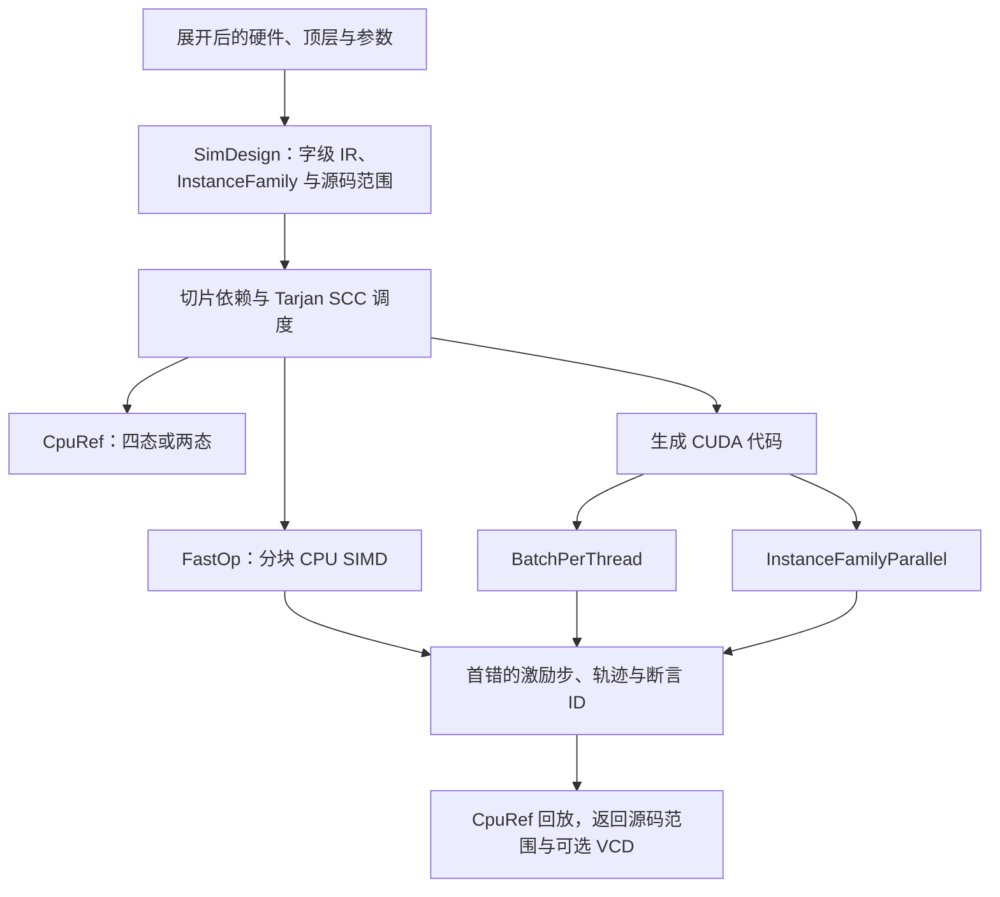

## 同一份特化设计，各实例独立保存状态

`SimDesign::lower` 接收 `syl_elab::ElaborationOutput`、顶层 cell 和参数绑定，求出位宽、展开生成作用域、拆分接口端口，并为信号、寄存器、RAM 端口和断言分配具体 ID。`InstanceFamily` 按规范模块与求值后的参数绑定归组。成员共享模板，各自保留独立存储、层次路径和源码范围，因此 GPU 执行同一份子实例代码后仍能定位出错实例。

若两个赋值访问打包总线中互不重叠的切片，按整字建图可能产生假环。下降阶段沿相连切片的边界拆分固定读取、复制及按位 AND/OR/XOR。Tarjan 强连通分量（SCC）算法识别跨实例的真实组合反馈。对于无环图，`comb_eval_order` 按依赖优先顺序排列可执行赋值。寄存器和同步 RAM 读输出切断组合路径。

## 数值、边沿与断言

T2 `CpuRef` 以数据位平面和未知位平面表示打包的 `Value`。已知位直接读取数据位；未知位对应的数据位为 0 时编码 X，为 1 时编码 Z。未初始化的寄存器、RAM 存储字与同步读输出初值为 X。同时到达的时钟边沿先采样旧存储值，再统一提交更新。同步读写同一地址时读到旧字。同步复位在时钟边沿采样复位表达式，异步复位置为有效时立即采样，仅释放复位不会改写存储。嵌入仿真器的应用须为每个 `extern` 实例注册 `ExternModel`，缺少模型时运行错误给出 Syl 实例路径。

加速批处理使用两态语义，存储初值为零，表达式中的 X/Z 位投影为零。加速子集支持单个外部时钟、同步复位、固定切片、多字宽总线，以及字宽不超过 64 位的 RAM。外部 cell、动态打包索引和宽位除法等运算超出该子集。检查 X 传播、异步复位或同时触发多个时钟时使用参考轨迹。对于确定性输入，`--fail-on-x` 和 `--strict-unique` 同样要求参考语义。

SplitMix64 根据种子、全局轨迹号、激励步、端口字索引及分字偏移生成激励。各后端对末拍输出字做加权归约，得到 64 位摘要。对于断言，归约保留最小的 `(激励步, 轨迹号, 断言 ID)`，结果与工作线程完成顺序无关。加速扫描持续到请求的最后一拍。回放按原有状态模式重新生成这一条轨迹，验证断言，并可将截至失败边沿的层次化波形写入 VCD。

## 两个并行维度

`B` 表示独立轨迹数，`N` 表示单个 DUT 内重复的实例数。在 CPU 上，`FastProgram` 将排好序的赋值和上升沿更新编译成扁平的 `FastOp` 数组。各工作线程独占一组按数组结构（SoA）存储的分块，每行连续存放不同轨迹同一位置的小端 `u64` 分字。七种特化设计的实测激励、稳定求值及时钟循环均为零堆分配。以 `-Ctarget-cpu=native` 构建的发布内核在 Ryzen 9 7950X 上使用八路 AVX-512 `vpaddq` 和 `vpandq`。

CUDA **Mode 1**（`BatchPerThread`）为每个线程分配一条完整轨迹，沿 `B` 维度并行。**Mode 2**（`InstanceFamilyParallel`）为每个线程块分配一条轨迹，块内线程在独立子树上执行同一份模板，再同步汇总父实例输出。各成员独立持有寄存器、RAM 和断言 ID。强制 family 模式且没有可映射的独立子实例时使用单线程块，因此串行依赖链增大 `N` 的收益有限。

四种基准源码位于 `examples/benchmarks/`。`wide_alu_array.syl` 的独立处理单元可共用模板；`deep_fsm_chain.syl` 中每级输出驱动下一级，形成组合依赖。`shared_ram_arbiter.syl` 的两个请求端口争用同一份 RAM，独立轨迹各自持有 RAM 副本。`fault_hunt_pipeline.syl` 在子实例中检测字节序列，用于核对首错坐标和回放。

## 实测吞吐与启动成本

CPU 矩阵使用 Ryzen 9 7950X（16 核/32 线程）及调优的 Verilator 5.052，每周期求值两次，采用 `-O3 -march=native`，各测点取实测最快的工作线程配置。GPU 矩阵使用 RTX 2080 Ti、CUDA 13.4（`nvcc` 13.4.92，`-O3 -arch=sm_75`）。吞吐单位为整批每秒推进的**百万个完整 DUT 周期**。CPU 热执行计时包含激励和最终摘要，GPU 内核计时不含进程启动、传输和归约。

`SimpleDualPortRam`（深度 16，`B=4096`）：

| 引擎 | 每条轨迹周期数 | 冷准备或编译 | 热循环或内核 | 百万周期/秒 |
| --- | ---: | ---: | ---: | ---: |
| CPU SIMD (SoA, 32T) | 256 | 2.049 ms | 0.6653 ms | 1,576 |
| Verilator (1 × 32) | 256 | 4,413 ms | 2.894 ms | 362 |
| CUDA (Mode 1) | 1,000 | 1,954.19 ms | 0.4669 ms | 8,772 |

在此 RAM 测点，已编译 GPU 程序的进程墙钟仍为 224.07 ms。对于 `LaneArray N=64, B=4096`，每条轨迹运行 16 拍，Verilator 吞吐为 11.54 Mcycles/s，SoA 为 2.37 Mcycles/s。CPU 短故障搜索在 `B=4096` 时定位到轨迹 3073、第 500 个边沿。16 个 SoA 工作线程的**冷启动总耗时为 3.14 ms**。Verilator 的**冷启动总耗时为 4.43 s**（构建 4.415 s，16 个宿主工作线程运行 9.637 ms）。[CPU 实测数据](https://github.com/syllang/syl/blob/3c7f4f48a9c7048e6325f67b4bb219981ed72d60/docs/benchmarks/t3_cpu_simd_verilator.md)

`LaneArray N=64`、每条轨迹 1,000 拍时，CUDA 冷编译在 Mode 1 耗时 17.155 s，在 Mode 2 耗时 2.311 s（**7.4×**）。`B=1` 时，内核加速 **18.1×**（121.753 降至 6.719 ms），对应热进程墙钟分别为 429.30 和 350.42 ms。增大 `B` 后，两种内核的快慢顺序反转。[GPU 实测数据](https://github.com/syllang/syl/blob/c510fed65b21a24e3d038a7db67441983a450cc4/docs/benchmarks/t3_rtx2080ti_gpu.md)

| B | Mode 1 (ms) | Mode 2 (ms) |
| ---: | ---: | ---: |
| 1 | 121.753 | 6.719 |
| 256 | 284.420 | 27.881 |
| 1,024 | 519.602 | 391.434 |
| 4,096 | 619.605 | 1,660.121 |
| 16,384 | 1,164.445 | 7,375.405 |

## `auto` 如何使用实测结果

1. 直接跟踪与四态检查需要 `CpuRef`。确定性批处理若 `B=1` 且少于 50,000 拍，也选择 `CpuRef`。设计无法编译为 `FastProgram` 时，自动路由使用参考后端。
2. 其余短任务使用 CPU SIMD。CUDA 工具链和设备可用时，若 `B × 周期数 >= 4,000,000`，或该乘积 `>= 256,000` 且命中缓存，即选择 CUDA。通过单条短轨迹判断后，至少 16 个可映射子实例且运行至少 1,000 拍的设计也可选 CUDA。CUDA 选择失败时，自动路由保留 CPU SIMD 程序。
3. 在 CUDA 内部，`B <= 256` 时自动映射尝试使用至少四个独立直属子实例的实例族。`B > 256` 或实例族映射失败时使用 Mode 1。这一保守阈值适用于多种设计；`N=64` 时的实测内核交叉区间位于 `B=1024` 和 `B=4096` 两个采样点之间。

T4 使用相同输入测量 CLI 缓存时，端到端墙钟从未命中的 **2,355 ms** 降至命中的 **576 ms**。热运行的 **`nvcc` 编译调用为零**。工具链发现仍会查询 `nvcc --version`，主机仍需探测设备并启动已编译的程序。[运行缓存批处理并回放故障](/zh/docs/how-to/native-simulation)
