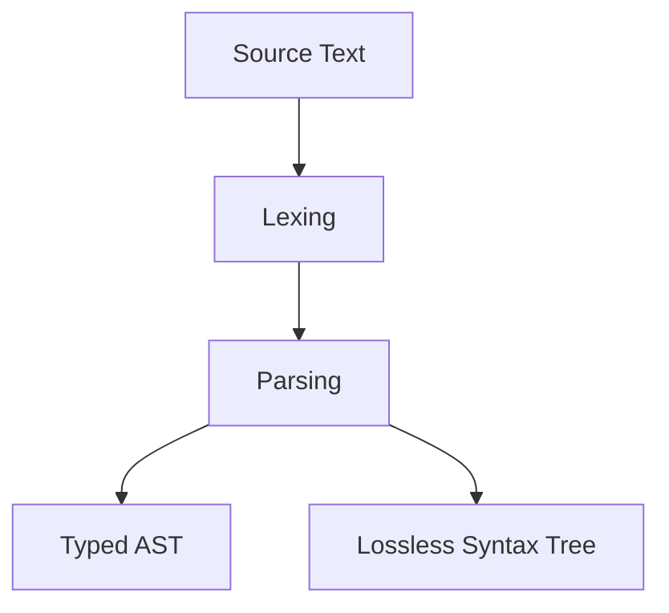
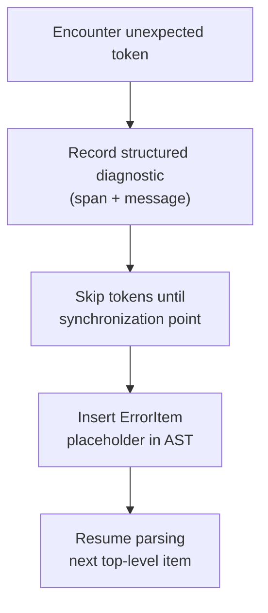

# Syntax and AST

Welcome to the Syntax and AST chapter! This page explains how the Syl compiler processes source code. We cover the overall design of the frontend (`syl_syntax`), lexing and parsing (including `Reset` polarity and `@cdc_sync` hardware syntax), why two trees—the typed AST and the lossless syntax tree—coexist, and how error recovery and stable node indexing work.

---

## Frontend Inputs and Outputs

The Syl frontend converts raw source text into structured representations. Given a source string, it produces two distinct structures:

- **Typed AST (`AstFile`)**: consumed by semantic analysis; contains only semantically meaningful nodes.
- **Lossless Syntax Tree (`LosslessSyntaxFile`)**: consumed by the LSP and formatters; preserves comments and whitespace.



## Lexing

The lexer reads a source string and outputs a token stream. Each token records three pieces of data:

- Token kind (keyword, identifier, operator, etc.)
- Token text slice
- Start and end source span

### Why Tokens?

The compiler does not operate on raw characters. Characters form sequences, whereas the parser needs meaningful syntactic units—for instance, `:=` is a single assignment operator, not a colon followed by an equals sign.

### Example

For this Syl snippet:

```syl
cell Top(x: in Bit) { }
```

The lexer emits 10 tokens:

```
cell     → Keyword Cell
Top      → Identifier Ident
(        → LParen
x        → Identifier Ident
:        → Colon
in       → Keyword In
Bit      → Identifier Ident
)        → RParen
{        → LBrace
}        → RBrace
```

Every token also records its exact line and column span for downstream diagnostics.

## Parsing

The parser consumes the token stream and builds a tree (AST), where each node corresponds to a syntactic construct.

### From Tokens to AST

Continuing the example above, after seeing `cell`, the parser expects a name, a parameter list in parentheses, and a body in braces:

```
Item::Cell {
    name: "Top",
    params: [
        Param { name: "x", dir: In, ty: "Bit" }
    ],
    body: Block { stmts: [], tail: None }
}
```

### Top-Level Declaration Kinds

Syl has 9 top-level declaration kinds, dispatched by their leading keyword:

| Keyword | Declaration Kind |
|---------|-----------------|
| `use` | Import declaration |
| `const` | Constant definition |
| `fn` | Function definition |
| `enum` | Enum definition |
| `bundle` | Bundle data structure |
| `interface` | Interface definition |
| `map` | Combinational map definition |
| `cell` | Hardware cell definition |
| `extern cell` | External cell declaration |

Each declaration has its own internal structure. For example, a `cell` includes a name, generic parameters, port list, optional return binding, and body:

```syl
cell Counter<W: Nat, D: Domain>(
    clk: in Clock<D>,
    rst: in Reset<D>,
    enable: in Bit,
) -> value: UInt<W> {

    reg count: UInt<W> reset(rst, 0)
    signal count_next: UInt<W> := count + 1
    next count := count_next
    value := count
}
```

### `Reset` Polarity and `@cdc_sync` Syntax

The frontend natively captures hardware domain and attribute syntax in the AST:

- **Attributes**: Annotations such as `@cdc_sync`, `@layout(flags)`, and `@layout(onehot)` are preserved as metadata nodes on declarations and statements for downstream CDC invariant checking and enum layout validation.
- **Reset polarity and domain parameters**: `Reset<D>` types and `reset(rst, init)` clauses on `reg` declarations preserve the explicit reset signal reference and initial value, supporting synchronous/asynchronous and active-high/low reset polarity semantics.

If any parsing step fails, the parser recovers instead of crashing.

## Why Two Trees?

This is a core architectural decision: the two trees serve different consumers with conflicting requirements.

**Typed AST (`AstFile`)** serves semantic analysis, which needs to know:

- This is a `Cell` named `Counter`
- It has generic parameters `W` and `D`
- Port `clk` has direction `in` and type `Clock<D>`

Comments and whitespace are noise to semantic analysis. Embedding them in the typed AST would force every semantic pass to skip them.

**Lossless Syntax Tree (`LosslessSyntaxFile`)** serves the editor (via LSP), which needs to know:

- Which token sits under the cursor at line 3, column 15
- How token offsets shift when a comment is inserted between lines 2 and 3
- Whether a file-header comment should be preserved

### How Both Trees Coexist

During a single parse pass, the parser tracks both:

- Typed AST nodes for semantic structure
- Token lists with kind, text, and span

When parsing finishes, the typed AST goes to semantic analysis, while the token list and node spans are assembled into the lossless syntax tree for the LSP. Lexing and parsing run **only once**.

### Internal Structure of the Lossless Tree

The root of the lossless tree is a `File` node containing two kinds of children:

- **Nodes**: syntactic constructs grouping child elements
- **Tokens**: lexical units carrying text and span

All tokens appear in exact source order, allowing byte-for-byte reconstruction of the original source text.

## Error Recovery

When the parser encounters invalid syntax, it performs error recovery to salvage as much valid structure as possible:



Synchronization points are top-level declaration boundaries (`cell`, `fn`, `const`, etc.) or closing braces (`}`). A syntax error inside one `cell` never corrupts the `cell`s that follow it.

## AST Node Indexing

AST node indexing assigns a stable ID to each node to support incremental LSP updates.

Node IDs are computed from:

1. Node kind (`Cell`, `Fn`, `Const`, etc.)
2. Position tag within the parent
3. Context of neighboring sibling nodes of different kinds

Inserting a comment at the top of a file or adding a new `cell Bar` after `cell Foo` does not invalidate `cell Foo`'s ID. Only identical consecutive nodes (e.g., two identical `const A = 1;` declarations) fall back to sequential numbering.

## Design Summary

- **Two trees, each minimal**: semantic analysis and LSP have different needs; neither is burdened by the other's data.
- **Single-pass construction**: lexing and parsing run once to produce both trees.
- **Error recovery**: partial, in-progress code in an editor still yields usable AST structure.
