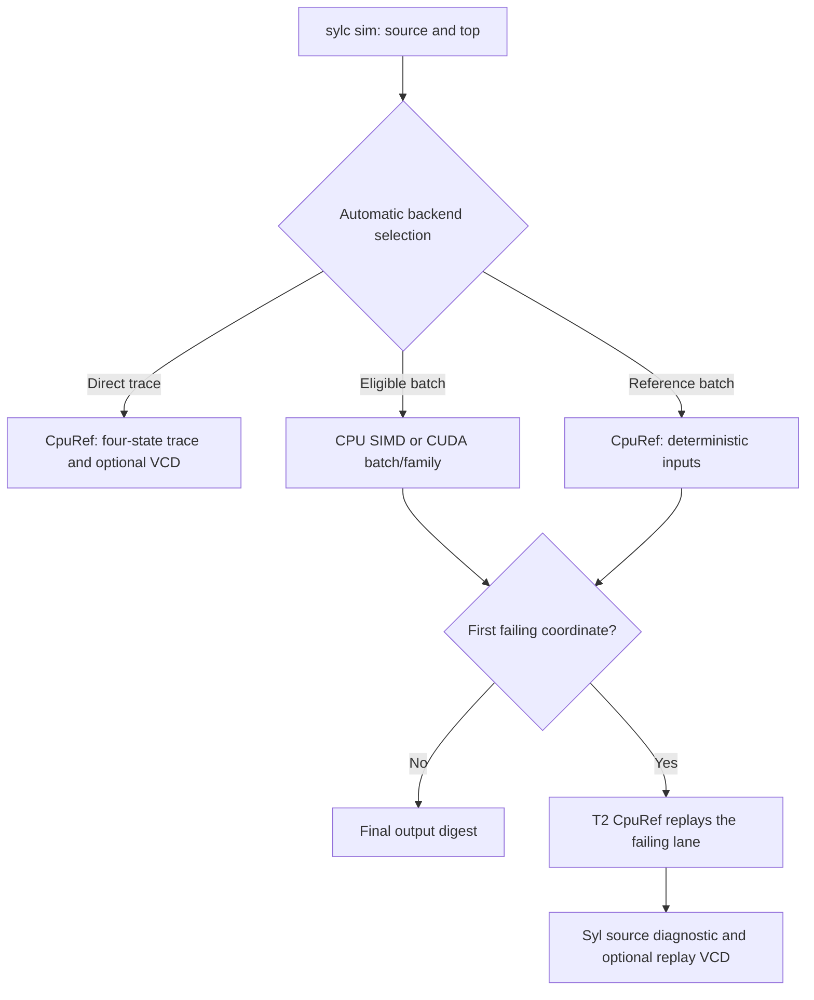

## Capture a four-state trace

Save this register as `sample.syl`. The rising edge samples `d`. An active synchronous reset loads zero.

```syl
cell Sample<D: Domain>(
    clk: in Clock<D>, rst: in Reset<D>, d: in UInt<4>,
) -> q: UInt<4> {
    reg saved: UInt<4> reset(rst, 0)
    next saved := d
    q := saved
}
```

```sh
sylc check sample.syl
sylc sim sample.syl --top Sample --cycles 2
```

The automatic run prints `Sample cycles=2` and `q=0000`. To check a known word and then an unknown word, save three steps in `steps.json`. Inputs retain their last driven value between steps.

```json
[
  {"drive":{"rst":true,"d":9},"clocks":["clk"],"expect":{"q":0}},
  {"drive":{"rst":false},"clocks":["clk"],"expect":{"q":"1001"}},
  {"drive":{"d":"0X1Z"},"clocks":["clk"],"expect":{"q":"0X1Z"}}
]
```

```sh
sylc sim sample.syl --top Sample --stimulus steps.json --vcd sample.vcd
```

Open `sample.vcd` in a waveform viewer and expand `Sample`. On the second rising edge, `saved` takes the value `1001`. On the third, both `saved` and `q` retain the X and Z bits. The CLI prints `Sample cycles=3` and `q=0x1z`. Add `--fail-on-x` when any unknown top output should fail the run.

## Compare the same trajectories across backends

Run the benchmark commands from the `syllang/syl` checkout. In `WideAluArray`, `N=4` instantiates four independent processing elements **inside each design**. `--batch 256` drives 256 independent copies of that design. Keep the seed, parameters, batch and cycle count fixed when comparing digests.

```sh
sylc sim examples/benchmarks/wide_alu_array.syl --top WideAluArray --param N=4 \
  --backend auto --batch 256 --cycles 100 --seed 42
sylc sim examples/benchmarks/wide_alu_array.syl --top WideAluArray --param N=4 \
  --backend cpu-simd --threads 4 --batch 256 --cycles 100 --seed 42
```

Both commands print `digest=14271358684969178033`. On a CUDA host with `nvcc` on `PATH`, compare one trajectory per thread (`batch`) with one trajectory per block (`family`). The latter distributes the four independent elements over threads in the block.

```sh
sylc sim examples/benchmarks/wide_alu_array.syl --top WideAluArray --param N=4 \
  --backend gpu-cuda --gpu-mode batch --batch 256 --cycles 100 --seed 42 \
  --gpu-cache-dir /tmp/syl-sim-cache
sylc sim examples/benchmarks/wide_alu_array.syl --top WideAluArray --param N=4 \
  --backend gpu-cuda --gpu-mode family --batch 256 --cycles 100 --seed 42 \
  --gpu-cache-dir /tmp/syl-sim-cache
```

The CUDA summaries identify `gpu-cuda/batch` or `gpu-cuda/family` and give the same digest. Repeat the same command to see `cache=hit` after the first `cache=miss`. To measure a cold invocation, replace `--gpu-cache-dir /tmp/syl-sim-cache` with `--no-gpu-cache`. `SYL_CUDA_ARCH=sm_75` selects the RTX 2080 Ti target. A change of generated code, architecture or compiler version selects a different cache key.

For a larger regression, run 4,096 trajectories for 1,000 cycles each. This crosses the automatic router’s cold CUDA workload threshold. Read the selected backend from the summary.

```sh
sylc sim examples/benchmarks/wide_alu_array.syl --top WideAluArray --param N=4 \
  --backend auto --batch 4096 --cycles 1000 --seed 42
```

In CPU-only CI, use `--backend auto`. If CUDA is unavailable, an eligible batch runs on CPU SIMD. A short single lane or a design outside the SIMD subset uses `cpu-ref`. An explicit `--backend gpu-cuda` reports a simulation error when its compiler or device is unavailable.

## Replay a failing assertion

`FaultHuntPipeline` checks four consecutive byte tags while `inject` enables the final fault. The fixed seed below reproduces the failure on both accelerated paths.

```sh
sylc sim examples/benchmarks/fault_hunt_pipeline.syl --top FaultHuntPipeline \
  --backend cpu-simd --threads 4 --batch 7 --cycles 12 --seed 2691343690239311708 \
  --replay-vcd fault.vcd
sylc sim examples/benchmarks/fault_hunt_pipeline.syl --top FaultHuntPipeline \
  --backend gpu-cuda --gpu-mode batch --no-gpu-cache \
  --batch 7 --cycles 12 --seed 2691343690239311708 --replay-vcd fault-gpu.vcd
```

```text
error[E_SIM]: batch 0, cycle 5, FaultHuntPipeline.guard.assert[0]: assert failed (assert 0)
```

Both commands intentionally exit with status `1` and point to `assert(not trip)` at `examples/benchmarks/fault_hunt_pipeline.syl:21:5`. After the scan, T2 `CpuRef` regenerates lane 0 from the seed and verifies the assertion ID at step 5. Expand `FaultHuntPipeline.guard` in either VCD to inspect `first`, `second`, `third` and `trip` from the settled baseline through the failing edge. A passing batch produces a digest and leaves the replay path untouched.



[CLI options and exit codes](/docs/reference/cli) · [Backend selection and measurements](/docs/explanation/simulation-and-gpu) · [Verify emitted SystemVerilog](/docs/how-to/verilator-and-yosys)
