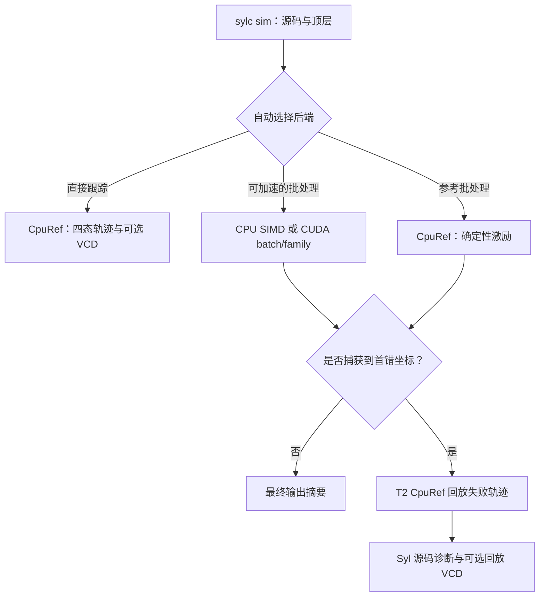

## 记录四态单轨迹

将寄存器保存为 `sample.syl`。上升沿采样 `d`，同步复位有效时写入零。

```syl
cell Sample<D: Domain>(
    clk: in Clock<D>, rst: in Reset<D>, d: in UInt<4>,
) -> q: UInt<4> {
    reg saved: UInt<4> reset(rst, 0)
    next saved := d
    q := saved
}
```

```sh
sylc check sample.syl
sylc sim sample.syl --top Sample --cycles 2
```

自动运行输出 `Sample cycles=2` 和 `q=0000`。将三个步骤保存为 `steps.json`，先检查已知字，再检查含未知位的字。输入在步骤之间保持上一次驱动的值。

```json
[
  {"drive":{"rst":true,"d":9},"clocks":["clk"],"expect":{"q":0}},
  {"drive":{"rst":false},"clocks":["clk"],"expect":{"q":"1001"}},
  {"drive":{"d":"0X1Z"},"clocks":["clk"],"expect":{"q":"0X1Z"}}
]
```

```sh
sylc sim sample.syl --top Sample --stimulus steps.json --vcd sample.vcd
```

在波形查看器中打开 `sample.vcd` 并展开 `Sample`。第二个上升沿把 `1001` 写入 `saved`。第三个上升沿后，`saved` 和 `q` 均保留 X 和 Z 位。CLI 输出 `Sample cycles=3` 和 `q=0x1z`。若要求每一步结束时顶层输出均为已知值，可加 `--fail-on-x`。

## 在不同后端比较同一组轨迹

在 `syllang/syl` 仓库根目录运行基准示例命令。`WideAluArray` 的 `N=4` 在**每个设计内部**实例化四个独立处理单元。`--batch 256` 驱动该设计的 256 条独立轨迹。比较摘要时应保持种子、参数、批量与周期数一致。

```sh
sylc sim examples/benchmarks/wide_alu_array.syl --top WideAluArray --param N=4 \
  --backend auto --batch 256 --cycles 100 --seed 42
sylc sim examples/benchmarks/wide_alu_array.syl --top WideAluArray --param N=4 \
  --backend cpu-simd --threads 4 --batch 256 --cycles 100 --seed 42
```

两条命令均输出 `digest=14271358684969178033`。在 `PATH` 中可找到 `nvcc` 的 CUDA 主机上，可比较每线程一条轨迹（`batch`）和每块一条轨迹（`family`）。后者把四个独立单元分给同一块内的线程。

```sh
sylc sim examples/benchmarks/wide_alu_array.syl --top WideAluArray --param N=4 \
  --backend gpu-cuda --gpu-mode batch --batch 256 --cycles 100 --seed 42 \
  --gpu-cache-dir /tmp/syl-sim-cache
sylc sim examples/benchmarks/wide_alu_array.syl --top WideAluArray --param N=4 \
  --backend gpu-cuda --gpu-mode family --batch 256 --cycles 100 --seed 42 \
  --gpu-cache-dir /tmp/syl-sim-cache
```

CUDA 输出标明 `gpu-cuda/batch` 或 `gpu-cuda/family`，摘要相同。首次 `cache=miss` 后重复同一命令，可看到 `cache=hit`。测量冷启动时，将 `--gpu-cache-dir /tmp/syl-sim-cache` 换成 `--no-gpu-cache`。`SYL_CUDA_ARCH=sm_75` 选择 RTX 2080 Ti 的目标架构。生成代码、架构或编译器版本变化时，缓存键随之改变。

扩大回归规模时，以下命令让 4,096 条轨迹各运行 1,000 拍。它跨过自动路由的冷 CUDA 工作量阈值，输出的 `backend` 字段给出实际后端。

```sh
sylc sim examples/benchmarks/wide_alu_array.syl --top WideAluArray --param N=4 \
  --backend auto --batch 4096 --cycles 1000 --seed 42
```

仅有 CPU 的 CI 可使用 `--backend auto`。CUDA 不可用时，符合条件的批处理使用 CPU SIMD；单条短轨迹或超出 SIMD 支持范围的设计使用 `cpu-ref`。显式指定 `--backend gpu-cuda` 时，缺少编译器或设备会产生仿真错误。

## 回放失败断言

`FaultHuntPipeline` 检查连续四个字节标签，`inject` 有效时最后一次匹配触发故障。以下固定种子可在两条加速路径上复现同一断言。

```sh
sylc sim examples/benchmarks/fault_hunt_pipeline.syl --top FaultHuntPipeline \
  --backend cpu-simd --threads 4 --batch 7 --cycles 12 --seed 2691343690239311708 \
  --replay-vcd fault.vcd
sylc sim examples/benchmarks/fault_hunt_pipeline.syl --top FaultHuntPipeline \
  --backend gpu-cuda --gpu-mode batch --no-gpu-cache \
  --batch 7 --cycles 12 --seed 2691343690239311708 --replay-vcd fault-gpu.vcd
```

```text
error[E_SIM]: batch 0, cycle 5, FaultHuntPipeline.guard.assert[0]: assert failed (assert 0)
```

两条命令均按预期以 `1` 退出，并指向 `examples/benchmarks/fault_hunt_pipeline.syl:21:5` 的 `assert(not trip)`。扫描结束后，T2 `CpuRef` 根据种子重新生成轨迹 0 的激励，在第 5 步验证断言 ID。在任一 VCD 中展开 `FaultHuntPipeline.guard`，即可查看从初始稳定状态到失败边沿的 `first`、`second`、`third` 和 `trip`。通过的批处理输出摘要，回放路径不会被写入。



[CLI 参数与退出码](/zh/docs/reference/cli) · [后端选择与实测数据](/zh/docs/explanation/simulation-and-gpu) · [验证生成的 SystemVerilog](/zh/docs/how-to/verilator-and-yosys)
