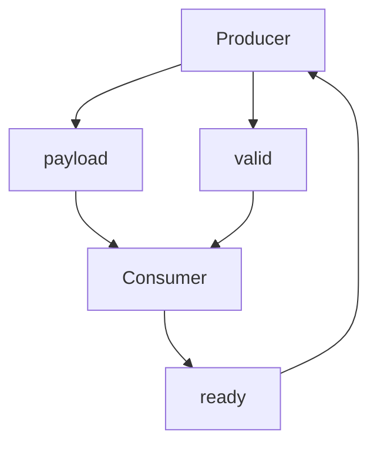

The `Stream` interface is the standard mechanism for passing data between Syl modules. It implements the valid-ready handshake protocol—the same flow-control foundation used by AXI-Stream and TileLink.

## The Valid-Ready Handshake

A producer and consumer coordinate transfers using two control signals:

- **`valid`**: Driven by the producer. Indicates `payload` is valid on the current cycle.
- **`ready`**: Driven by the consumer. Indicates the consumer can accept `payload` on the current cycle.

A transfer (handshake) occurs on a clock edge when both `valid` and `ready` are `1`.



## The `Stream<T>` Interface

```syl
interface Stream<T> {
    payload: T
    valid: Bit
    ready: Bit

    view source {
        out payload
        out valid
        in ready
    }

    view sink {
        in payload
        in valid
        out ready
    }
}
```

- `T` is the payload type (e.g. `UInt<8>` or a `bundle`).
- `source` view: Producer perspective (`payload` and `valid` are `out`, `ready` is `in`).
- `sink` view: Consumer perspective (`payload` and `valid` are `in`, `ready` is `out`).

## Producer and Consumer

```syl
cell Producer<D: Domain>(
    clk: in Clock<D>,
    rst: in Reset<D>,
    stream: out Stream<UInt<8>>.source,
) {
    reg data: UInt<8> reset(rst, 0)
    signal handshake: Bit := stream.valid and stream.ready

    next data := select {
        handshake => data + 1,
        default => data,
    }

    stream.payload := data
    stream.valid := 1
}

cell Consumer<D: Domain>(
    clk: in Clock<D>,
    rst: in Reset<D>,
    stream: in Stream<UInt<8>>.sink,
) {
    signal handshake: Bit := stream.valid and stream.ready

    reg received: UInt<8> reset(rst, 0)
    next received := select {
        handshake => stream.payload,
        default => received,
    }

    stream.ready := 1
}
```

## Backpressure & Composing `std.skid`, `std.arbiter`, and `std.fifo`

When a downstream consumer stalls (`ready == 0`), the upstream producer must hold `valid` and `payload` stable until `ready` returns to `1`. To break combinational `ready` paths or buffer bursts, compose `Stream` with standard library modules:

- **`std.skid`**: Inserts a 2-entry skid buffer to register both `valid`/`payload` and `ready`, breaking combinational backpressure loops without losing throughput.
- **`std.fifo`**: Decouples producer and consumer rates with a synchronous circular buffer (`SyncFifo`).
- **`std.arbiter`**: Arbitrates multiple `Stream<T>.sink` inputs onto a single `Stream<T>.source` output (round-robin or fixed priority).

```syl
use std.stream.Stream
use std.skid.SkidBuffer
use std.fifo.SyncFifo

-- Decouple combinational ready path with a skid buffer, then buffer bursts in a FIFO
let skidded = place SkidBuffer<UInt<8>, D>(clk: clk, rst: rst, input: in_stream)
let buffered = place SyncFifo<UInt<8>, 16, D>(clk: clk, rst: rst, input: skidded.output)
```

## Common Pitfalls

1. **Combinational loop on `ready`**: Never drive `source.valid` combinationally from `source.ready`.
2. **Dropping `valid` under stall**: Once `valid` is `1` and `ready` is `0`, `valid` and `payload` must remain unchanged on the next cycle.

## Stream Composition Patterns

### 1. Skid Buffer (`std.skid.SkidBuffer`)

A skid buffer registers both forward (`valid`, `payload`) and backward (`ready`) paths, breaking long combinational `ready` chains while maintaining 100% throughput (1 transfer per cycle):

```syl
use std.stream.Stream
use std.skid.SkidBuffer

cell PipelineBoundary<D: Domain>(
    clk: in Clock<D>,
    rst: in Reset<D, Sync, ActiveHigh>,
    in_s: in Stream<UInt<32>>.sink,
    out_s: out Stream<UInt<32>>.source,
) {
    let skid = place SkidBuffer<UInt<32>, D>(
        clk: clk,
        rst: rst,
        input: in_s,
        output: out_s,
    )
}
```

### 2. Synchronous FIFO (`std.fifo.SyncFifo`)

Use `SyncFifo` to absorb bursty traffic between producers and consumers:

```syl
use std.stream.Stream
use std.fifo.SyncFifo

cell BurstBuffer<D: Domain>(
    clk: in Clock<D>,
    rst: in Reset<D, Sync, ActiveHigh>,
    in_s: in Stream<UInt<16>>.sink,
    out_s: out Stream<UInt<16>>.source,
) {
    let fifo = place SyncFifo<UInt<16>, 16, D>(
        clk: clk,
        rst: rst,
        input: in_s,
        output: out_s,
    )
}
```

### 3. Stream Arbiter (`std.arbiter`)

When multiple producers share a single downstream sink, use `std.arbiter` to arbitrate cleanly without dropping valid/ready invariants:

```syl
use std.stream.Stream
use std.arbiter.RoundRobinArbiter2

cell TwoToOneMux<D: Domain>(
    clk: in Clock<D>,
    rst: in Reset<D, Sync, ActiveHigh>,
    in0: in Stream<UInt<8>>.sink,
    in1: in Stream<UInt<8>>.sink,
    out_s: out Stream<UInt<8>>.source,
) {
    let arb = place RoundRobinArbiter2<UInt<8>, D>(
        clk: clk,
        rst: rst,
        in0: in0,
        in1: in1,
        output: out_s,
    )
}
```

## Protocol Invariants Checklist

| Invariant | Description |
| :--- | :--- |
| **Stability under stall** | If `valid == 1` and `ready == 0`, `valid` and `payload` must remain unchanged on the next cycle. |
| **No combinational `valid` from `ready`** | `source.valid` must never depend combinationally on `source.ready`. |
| **Single-cycle handshake** | A transfer occurs if and only if `valid and ready == 1` at the rising clock edge. |
| **Reset state** | `valid` must reset to `0` so spurious data is not transferred during reset. |
