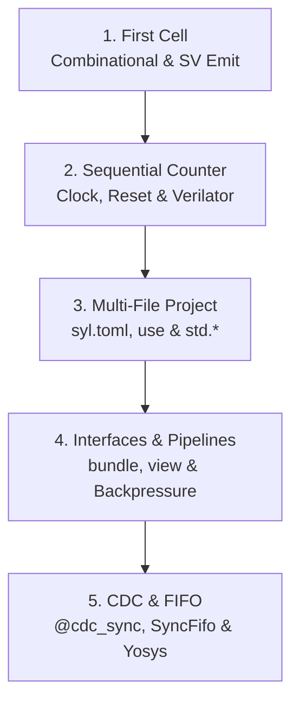

# Syl Tutorials

These five progressive lessons build combinational logic, a sequential counter, a multi-file project, an interface pipeline, and a clock-domain-crossing FIFO—covering design rationale, hardware semantics, and compile-time checks at each step.

## Learning Path

| Lesson | What You Will Build | Key Concepts | Verification |
| :--- | :--- | :--- | :--- |
| [1. Your First Cell](/docs/tutorials/first-cell) | A combinational saturating adder (`SatAdd8`) | `cell`, `in`/`out`, `u<8>`, `:=`, width safety, `sylc check`, `sylc emit` | `sylc` type & width checks, SystemVerilog inspection |
| [2. Sequential Counter & Simulation](/docs/tutorials/sequential-counter-sim) | A synchronous up-counter with enable and wrap (`Counter8`) | `domain`, `Clock<D>`, `Reset<D>`, `reg`, sync/async reset polarity | Verilator C++17 cycle-accurate testbench |
| [3. Multi-File Project](/docs/tutorials/multi-file-project) | A debounced pulse-controlled skid buffer | `syl.toml`, module paths, `use`, `std.pulse`, `std.skid`, `--out-dir`, `--filelist` | Multi-file SV emission with `--source-comments` |
| [4. Interfaces & Pipelines](/docs/tutorials/interfaces-and-pipelines) | A 2-stage valid/ready arithmetic pipeline with arbitration | `bundle`, `interface`, `view`, `std.stream`, `std.stage`, `std.pipeline`, `std.arbiter` | Static single-driver & direction checks |
| [5. CDC & FIFO](/docs/tutorials/cdc-and-fifo) | A dual-clock FIFO bridge between `clk_a` and `clk_b` | `E_MIDDLE_CDC_VIOLATION`, `@cdc_sync`, `std.cdc`, `std.mem`, `std.fifo` | Verilator dual-clock sim & Yosys synthesis |

## Prerequisites

Before starting [Lesson 1](/docs/tutorials/first-cell), make sure you have:

1. **The `sylc` compiler** on your `PATH` (or know its path, e.g. `sylc --version` prints `sylc 0.1.0`).
2. **A C++17 compiler and Verilator** (`verilator --version` and `g++ --version`) for [Lesson 2](/docs/tutorials/sequential-counter-sim) onward.
3. **Yosys** (`yosys -V`) for synthesis verification in [Lesson 5](/docs/tutorials/cdc-and-fifo).

## How to Use These Tutorials

- **Type or copy every step**: Each lesson evolves a working design from a minimal skeleton to a verified circuit.
- **Trigger the negative examples intentionally**: When a lesson shows a compile-time error (such as a width mismatch or a CDC violation), try running `sylc check` on the broken code first so you learn to read Syl's diagnostics.
- **Inspect the generated SystemVerilog**: Syl compiles to a clean, synthesis-ready MVP SystemVerilog subset. Reading the emitted `.sv` alongside your `.syl` source builds intuition for how high-level abstractions map to wires and flip-flops.
