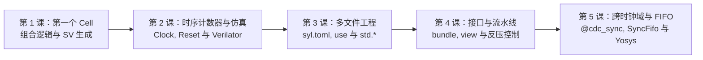

# Syl 实战教程

欢迎来到 Syl 实战教程系列。本系列不孤立地罗列语法规则，而是通过五个连贯的工程案例，带你从零编写、检查、仿真并综合真实的数字电路——在每一步解释**为什么这样设计**、代码对应的**硬件语义是什么**，以及编译器如何在你打开仿真器之前就拦截掉常见硬件缺陷。

## 学习路径导图

| 课程 | 实战目标 | 核心概念 | 验证方式 |
| :--- | :--- | :--- | :--- |
| [第 1 课：你的第一个 Cell](/docs/tutorials/first-cell) | 组合逻辑饱和加法器（`SatAdd8`） | `cell`、`in`/`out`、`u<8>`、`:=`、位宽安全、`sylc check`、`sylc emit` | `sylc` 类型与位宽检查、SystemVerilog 代码解读 |
| [第 2 课：时序计数器与仿真](/docs/tutorials/sequential-counter-sim) | 带使能与回绕的同步递增计数器（`Counter8`） | `domain`、`Clock<D>`、`Reset<D>`、`reg`、同步/异步复位极性 | Verilator C++17 周期级 testbench |
| [第 3 课：多文件工程](/docs/tutorials/multi-file-project) | 带脉冲消抖控制的 Skid Buffer | `syl.toml`、模块路径、`use`、`std.pulse`、`std.skid`、`--out-dir`、`--filelist` | 多文件 SV 发射与 `--source-comments` |
| [第 4 课：接口与流水线](/docs/tutorials/interfaces-and-pipelines) | 带握手反压与仲裁的两级算术流水线 | `bundle`、`interface`、`view`、`std.stream`、`std.stage`、`std.pipeline`、`std.arbiter` | 静态单驱动与接口方向检查 |
| [第 5 课：跨时钟域与 FIFO](/docs/tutorials/cdc-and-fifo) | 连接 `clk_a` 与 `clk_b` 的双时钟域 FIFO 桥接 | `E_MIDDLE_CDC_VIOLATION`、`@cdc_sync`、`std.cdc`、`std.mem`、`std.fifo` | Verilator 双时钟仿真与 Yosys 综合检查 |

## 前置条件

在开始[第 1 课](/docs/tutorials/first-cell)之前，请确认你的环境中已具备：

1. **`sylc` 编译器**：已加入 `PATH`（或已知其路径，例如运行 `sylc --version` 输出 `sylc 0.1.0`）。
2. **C++17 编译器与 Verilator**：`verilator --version` 与 `g++ --version` 可用，用于[第 2 课](/docs/tutorials/sequential-counter-sim)及后续的周期级仿真。
3. **Yosys**：`yosys -V` 可用，用于[第 5 课](/docs/tutorials/cdc-and-fifo)的综合网表检查。

## 如何使用本教程

- **亲手敲出每一步演进**：每课都会从一个最小骨架出发，逐步演进为经过验证的完整电路。
- **主动触发反例**：当教程展示编译期错误（如位宽不匹配或跨时钟域违规）时，建议你先用 `sylc check` 亲自运行一遍错误代码，熟悉 Syl 的诊断信息。
- **对照阅读生成的 SystemVerilog**：Syl 会将设计降级为清晰、可综合的 MVP SystemVerilog 子集。对照 `.syl` 与生成的 `.sv`，能帮你快速建立高级抽象与底层连线、触发器之间的直觉联系。
